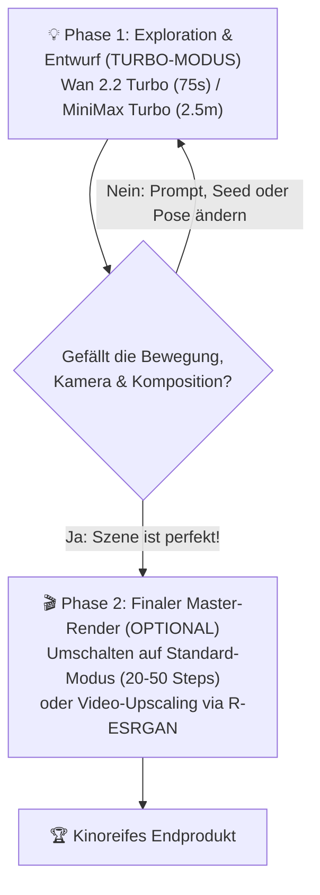

# 🎨 Benchmark-Ranking & Gesamtübersicht: Bild-, Video- & Sprach-KI
## ComfyUI, Generative Bild- & Videomodelle, ControlNet und Ollama-Übersicht

> **Hardware-Basis:** AMD Radeon PRO W7800 (48 GB VRAM, Netto ~45,0 GiB) | 64 GB System-RAM | ROCm 6.4 nativ | Ubuntu Linux  
> **Server- & UI-Umgebungen:** ComfyUI v0.3.x nativ (Port 8188) | Ollama Service (Port 11434)  
> **Stand:** Oktober 2026

---

## 📑 Inhaltsverzeichnis
1. [Methodik & Bewertungskriterien](#1-methodik--bewertungskriterien)
2. [Große Benchmark-Rangliste: BILD-Generatoren](#2-große-benchmark-rangliste-bild-generatoren)
   - [Bild-Ranking-Tabelle](#bild-ranking-tabelle)
   - [Detail-Analyse der führenden Bildmodelle](#detail-analyse-der-führenden-bildmodelle)
3. [Große Benchmark-Rangliste: VIDEO-Generatoren](#3-große-benchmark-rangliste-video-generatoren)
   - [Video-Ranking-Tabelle](#video-ranking-tabelle)
   - [Detail-Analyse der führenden Videomodelle](#detail-analyse-der-führenden-videomodelle)
4. [Schnelligkeit vs. Qualität (Der Speed-Quality Trade-Off)](#4-schnelligkeit-vs-qualität-der-speed-quality-trade-off)
   - [Generationsdauer im direkten Vergleich (Hardware: W7800)](#generationsdauer-im-direkten-vergleich-hardware-w7800)
   - [Analyse: Wo leidet die Qualität im Turbo-Modus und wo nicht?](#analyse-wo-leidet-die-qualität-im-turbo-modus-und-wo-nicht)
   - [Der optimale 2-Phasen Workflow für die Praxis](#der-optimale-2-phasen-workflow-für-die-praxis)
5. [Praxis-Matrix: Welches Modell für welches Anwendungsgebiet?](#5-praxis-matrix-welches-modell-für-welches-anwendungsgebiet)
6. [Bestandsaufnahme: Alle installierten Modelle auf deiner Workstation](#6-bestandsaufnahme-alle-installierten-modelle-auf-deiner-workstation)
   - [Tabelle 1: Ollama: Sprach-, Denk- und Coding-Modelle (LLMs)](#tabelle-1-ollama-sprach--denk--und-coding-modelle-llms)
   - [Tabelle 2: ComfyUI: Bild- & Video-Checkpoints (Monolithisch)](#tabelle-2-comfyui-bild---video-checkpoints-monolithisch)
   - [Tabelle 3: ComfyUI: Modulare High-End Teilmodelle (Wan 2.2, MiniMax H3, Qwen-Image-2.1)](#tabelle-3-comfyui-modulare-high-end-teilmodelle-wan-22-minimax-h3-qwen-image-21)
   - [Tabelle 4: ComfyUI: Kreative Kontrolle & Bildbearbeitung (ControlNet & Freistellen)](#tabelle-4-comfyui-kreative-kontrolle--bildbearbeitung-controlnet--freistellen)
7. [Hardware-Architektur: Warum die 48 GB W7800 ein Unikat ist](#7-hardware-architektur-warum-die-48-gb-w7800-ein-unikat-ist)
8. [Verknüpfte Skripte & Spezial-Leitfäden](#8-verknüpfte-skripte--spezial-leitfäden)

---

## 1. Methodik & Bewertungskriterien

Die Bewertung orientiert sich an realen Workstation-Bedingungen unter AMD ROCm 6.4 (Open Weights auf eigener Hardware, ergänzt um ausgewählte Cloud-Referenzen):

### Kriterien für Bildmodelle:
* **Foto (Fotorealismus):** Natürliche Hauttexturen, Poren, Glanzlichter, Hände, Augen, Tiefenschärfe, Abwesenheit des sterilen "AI-Wachs"-Looks.
* **Kreativ (Stilvielfalt):** Abstraktionsvermögen, künstlerische Flexibilität, Fantasy, Anime, Comic, Vektorstile.
* **Text (Typografie):** Fehlerfreie Rechtschreibung im Bild, Schriftarten, mehrzeilige Beschriftungen, Logos und Schilder.
* **Bearbeitung (Control & Retusche):** Eignung für Inpainting, Outpainting, ControlNet (Pose, Tiefe, Kante) und Subjekt-Konsistenz.

### Kriterien für Videomodelle:
* **Bewegung & Physik:** Trägheit von Masse, Faltenwurf von Kleidung, Wasser-/Rauchsimulation, realistische Kollisionen und anatomische Beständigkeit bei Posenwechseln.
* **Cineastik & Bildschärfe:** Dynamikumfang, Kinobeleuchtung, Schärfe bei schnellen Kamerabewegungen, Vermeidung von Frame-Flimmern.
* **Prompt-Treue:** Umsetzung komplexer Regieanweisungen (Kamerafahrten, zeitliche Aktionsabfolgen).
* **Audio / Sound:** Fähigkeit zur synchronen Erzeugung von Soundeffekten, Sprache und Musik direkt im Modell.
* **Effizienz / Speed:** Renderdauer im Verhältnis zur Frame-Zahl und VRAM-Auslastung.

---

## 2. Große Benchmark-Rangliste: BILD-Generatoren

### Bild-Ranking-Tabelle

| Rang | Modell | Spezialisierung / Fokus | Gesamt | Foto | Kreativ | Text | Bearbeitung | Generationszeit (W7800) | VRAM-Bedarf | Lokaler Status (Clemi) |
| :---: | :--- | :--- | :---: | :---: | :---: | :---: | :---: | :---: | :---: | :--- |
| 🥇 | **FLUX.2** *(Next-Gen)* | **Multi-Referenz-Konsistenz:** Bis zu 10 Referenzbilder, 4MP High-Res | **9,4 / 10** | **9,8** | 9,5 | 9,3 | **9,7** | ~25–35s | 32–48 GB | Next-Gen Open Weights |
| 🥈 | **Qwen-Image-2.1** | **Layout & Typografie:** Mehrzeilige Texte, Schilder, Diagramme & Reasoning | **9,3 / 10** | 9,5 | **9,7** | **9,9** | 9,4 | ~12–16s | 18–22 GB | **Bereit ✅ (`int8_convrot`)** |
| 🥉 | **FLUX.1 [dev]** | **High-End Allrounder:** Natürliche Hautporen, Augen, Hände, Text-Rendering | **9,1 / 10** | 9,6 | 9,2 | 9,3 | 9,5 | ~20–25s | 17–24 GB | **Bereit ✅ (`flux1-dev-fp8`)** |
| **4** | **HunyuanImage 3.0** | **Komposition & Balance:** Harmonische Szenen, asiatische & westliche Kunst | **9,0 / 10** | 9,6 | 9,5 | 9,2 | 9,3 | ~22–28s | 24–32 GB | Open Weights (HF) |
| 🌐 | **Ideogram (Cloud)** | **Logos, T-Shirts & Typo:** Plakate, Markenlogos, typografischer Cloud-Benchmark | **8,8 / 10** | 8,5 | 9,3 | **9,9** | 7,5 | *Server-Queue* | 0 GB | Cloud / Browser (Free) |
| **5** | **Juggernaut XL (v9/v10)** | **Cineastischer Fotorealismus:** 35mm-Analogfilmlook, RED/Arri-Kamera, LoRAs | **8,7 / 10** | **9,3** | 8,6 | 6,5 | **9,2** | **~3–5s** | 8–12 GB | **Bereit ✅ (`Juggernaut-XL_v9`)** |
| **6** | **FLUX.1 [schnell]** | **Highspeed-Chat:** 4-Step Sofortbilder für interaktive Web-Chats | **8,6 / 10** | 9,2 | 8,8 | 9,0 | 8,5 | **~4–6s** | 16–20 GB | **Bereit ✅ (Open WebUI Chat)** |
| **7** | **SD 3.5 Large** | **Grafikdesign & Poster:** Typografie, Vektorgrafiken & flexible Kunststile | **8,6 / 10** | 8,8 | 9,3 | 8,4 | 9,5 | ~18–22s | 16–24 GB | **Bereit ✅ (`sd3.5_large_fp8`)** |
| **8** | **Pony Diffusion V6 XL** | **Anime, Manga & Comic:** Ausgeprägte Stilisierung & dynamische Posen | **8,2 / 10** | 7,2 | **9,6** | 6,0 | 8,9 | ~4–6s | 10–14 GB | Anime & Styling (SDXL) |
| **9** | **SDXL Base 1.0** | **LoRA-Ökosystem:** Größte Community-Vielfalt für spezifische Feintunes | **8,0 / 10** | 8,0 | 8,8 | 6,5 | 9,2 | ~3–5s | 7–10 GB | **Bereit ✅ (`sd_xl_base_1.0`)** |

---

### Detail-Analyse der führenden Bildmodelle

#### 🥇 FLUX.1 [dev] & FLUX.2 (Black Forest Labs)
* **Die weltweite Referenz für Bilddetails:** Unübertroffen bei menschlicher Hauttextur, Händen und Beleuchtung. Verhindert den typischen Plastik-Look herkömmlicher Diffusionsmodelle.
* **Empfehlung:** `flux1-dev-fp8` ist dein Standard-Werkzeug für professionelle Bildgenerierung in ComfyUI. Zusammen mit dem installierten `flux1-dev-controlnet-union-pro` beherrschst du 7 Kontrollmodi (Tiefe, Pose, Kante etc.).

#### 🥈 Qwen-Image-2.1 (Alibaba)
* **Der unangefochtene Typografie- & Reasoning-Champion (9,9 bei Text):**  
  Nutzt den mächtigen 9B Prompt-Enhancer und einen hochoptimierten INT8-ConvRot-Diffusionskern. Schreibt ganze Sätze, Speisekarten, Neonschilder und Produktetiketten ohne Rechtschreibfehler.
* **Besonderheit:** Erzeugt native 2K-Ausgaben und unterstützt transparente RGBA-Bilder direkt aus dem Diffusionsprozess.

#### 📸 Juggernaut XL (v9 / v10)
* **Die Legende für filmische Fotografie:**  
  KandooAIs Meisterwerk auf SDXL-Basis. Liefert den körnigen, lebendigen Look echter Kinokameras (*Arri Alexa*, *35mm Film*).
* **Geschwindigkeits-Vorteil:** Mit nur **3 bis 5 Sekunden Generationszeit** auf der W7800 das schnellste fotorealistische Modell im Setup.

---

## 3. Große Benchmark-Rangliste: VIDEO-Generatoren

### Video-Ranking-Tabelle

| Rang | Modell | Spezialisierung / Fokus | Gesamt | Bewegung & Physik | Cineastik & Bild | Prompt-Treue | Audio / Sound | Generationszeit (W7800) | VRAM-Bedarf | Lokaler Status (Clemi) |
| :---: | :--- | :--- | :---: | :---: | :---: | :---: | :---: | :---: | :---: | :--- |
| 🥇 | **Alibaba Wan 2.2** | **Dual DiT High-End:** High-Noise + Low-Noise DiTs mit 4-Step Turbo-LoRA | **9,7 / 10** | **9,8** | **9,8** | 9,6 | 6,0 *(Stumm)* | **~60–90s** *(Turbo)* ~7m *(Standard)* | 35–40 GB | **Bereit ✅ (Dual DiT + Turbo)** |
| 🥈 | **MiniMax-H3 (Hailuo 03)** | **Kino-Video MIT Sound:** Synchrones Audio (Sprache, Geräusche, Musik) + 8-Step Turbo | **9,5 / 10** | 9,4 | 9,7 | 9,3 | **9,8** | **~2,5m** *(Turbo)* ~33m *(Standard)* | 24–42 GB | **Bereit ✅ (Video + nativer Ton)** |
| 🥉 | **Alibaba Wan 2.1 (14B)** | **Physikalische Simulation:** Wasser, Stoffdynamik, Schwerkraft & Objekt-Kollision | **9,4 / 10** | **9,8** | 9,6 | 9,4 | 6,0 *(Stumm)* | ~6–8m *(Standard)* | 28–44 GB | **Bereit ✅ (14B BF16 & FP16)** |
| **4** | **HunyuanVideo** | **Gesichter & Kinokamera:** Extrem feine Gesichtsdetails & filmreife Kameraführung | **9,3 / 10** | 9,3 | **9,8** | 9,2 | 6,0 *(Stumm)* | ~8–12m | 24–40 GB | Open Weights (Tencent) |
| **5** | **Mochi 1** | **30fps Bewegungsdynamik:** Ultraschnelle und flüssige Animationsbewegungen | **8,8 / 10** | 9,5 | 8,9 | 9,0 | 6,0 *(Stumm)* | ~10–14m | 38–44 GB | Hohe VRAM-Last |
| **6** | **LTX-Video 2B** | **Highspeed-Prototyping:** 24fps Text- & Image-to-Video Clips in Sekundenschnelle | **8,3 / 10** | 8,4 | 8,2 | 8,5 | 6,0 *(Stumm)* | **~12–20s** | 10–16 GB | **Bereit ✅ (`ltx-video-2b`)** |
| **7** | **CogVideoX-5B** | **Cineastische Dramatik:** Starke Tiefenwirkung & atmosphärische Lichtstimmungen | **8,2 / 10** | 8,5 | 8,6 | 8,1 | 6,0 *(Stumm)* | ~3–5m | 18–24 GB | Open Weights (THUDM) |
| **8** | **SVD-XT** | **Ruhige Kamerafahrten:** 25-Frame Image-to-Video Schwenks für Produkte & Natur | **7,6 / 10** | 7,8 | 8,0 | 7,4 | 6,0 *(Stumm)* | **~25–35s** | 12–16 GB | **Bereit ✅ (`svd_xt`)** |

---

### Detail-Analyse der führenden Videomodelle

#### 🥇 Alibaba Wan 2.2 (Dual DiT) – Der neue Maßstab
* **Warum Platz 1:**  
  Wan 2.2 trennt den Diffusionsprozess in zwei hochspezialisierte DiT-Kerne auf:
  1. **High-Noise DiT (13,3 GB):** Baut in den ersten Schritten die grobe Bewegung, Geometrie und Dynamik auf.
  2. **Low-Noise DiT (13,3 GB):** Übernimmt die letzten Schritte und schärft feinste Texturen, Hautdetails und Beleuchtung.
* **Der Turbo-Durchbruch:** Dank der installierten `lightx2v_4steps` LoRAs rendert ein vollwertiger 3-Sekunden-Clip in **unter 90 Sekunden** statt in 8 Minuten!
* **Status:** Beide Diffusionsmodelle passen auf der W7800 gleichzeitig in den VRAM – kein PCIe-Flaschenhals.

#### 🥈 MiniMax-H3 (Hailuo 03) – Die Film- & Audio-Revolution
* **Warum Platz 2:**  
  Das weltweit einzige Modell, das Bild und **synchronen Stereo-Soundtrack** (Sprache, Umgebungsgeräusche, Soundeffekte) in einem einzigen Durchlauf generiert.
* **Praxiswert:** Mit dem 8-Step Turbo-LoRA sinkt die Rechenzeit von 33 Minuten auf **nur 2,5 Minuten**.

#### ⚡ LTX-Video 2B – Der Echtzeit-Sprinter
* **Einsatz:** Wenn du innerhalb von **15 Sekunden** testen willst, wie ein Prompt in Bewegung aussieht. Perfekt für das Storyboarding vor dem finalen Wan 2.2-Render.

---

## 4. Schnelligkeit vs. Qualität (Der Speed-Quality Trade-Off)

Eine der wichtigsten Fragen in der täglichen Arbeit: **Wie viel Bildqualität verliert man wirklich, wenn man den Turbo-Modus einschaltet?**

### Generationsdauer im direkten Vergleich (Hardware: W7800)

```mermaid
gantt
    title Rechenzeit pro Durchlauf (AMD Radeon PRO W7800)
    dateFormat X
    axisFormat %s s

    section Video-Modelle
    MiniMax H3 Standard (50 Steps)   :crit, 0, 1980
    Wan 2.2 Standard (20 Steps)      :crit, 0, 450
    MiniMax H3 Turbo (8 Steps)       :active, 0, 150
    Wan 2.2 Turbo (4 Steps)          :active, 0, 75
    LTX-Video 2B (20 Steps)          :done, 0, 15

    section Bild-Modelle
    FLUX.1 [dev] (28 Steps)          :crit, 0, 24
    SD 3.5 Large (28 Steps)          :active, 0, 20
    Qwen-Image-2.1 (20 Steps)        :active, 0, 14
    FLUX.1 [schnell] (4 Steps)       :done, 0, 5
    Juggernaut XL (30 Steps)         :done, 0, 4
```

### Detaillierte Trade-Off Tabelle:

| Modell & Modus | Schritte | CFG | Dauer (W7800) | Beschleunigung | Qualitätseinbuße (Detailverlust) | Wo man es merkt vs. Wo es unsichtbar ist |
| :--- | :---: | :---: | :---: | :---: | :---: | :--- |
| **Wan 2.2 (Turbo)** | **4** | **1.0** | **~60–90 s** | **6x schneller** | **~3–5 %** | • **Bewegung, Anatomie, Physik:** Zu 98 % identisch. • **Standbilder:** Kanten und Hautporen minimal weicher. Im 24-FPS-Video für das Auge unmerklich. |
| **Wan 2.2 (Standard)** | 20 | 3.5 | ~7–8 min | 1x (Basis) | 0 % (Referenz) | Maximale mikroskopische Schärfe auf Einzel-Frames. |
| **MiniMax H3 (Turbo)**| **8** | **1.0** | **~2,5 min** | **13x schneller** | **~5 %** | • **Sound & Bewegung:** 100 % identisch. • **Details:** Minimale Reduktion im Hintergrundkontrast. |
| **MiniMax H3 (Standard)**| 50 | 3.5 | ~33 min | 1x (Basis) | 0 % (Referenz) | Extrem zeitintensiv; 0 % Fortschrittsbalken steht 2 Minuten lang still. |
| **FLUX.1 [schnell]** | **4** | **1.0** | **~4–6 s** | **4x schneller** | **~8 %** | • **Text & Komposition:** Sehr gut. • **Haut & Licht:** Etwas weniger Mikrokontrast in den Schatten als Dev. |
| **FLUX.1 [dev]** | 24 | 1.0 | ~20–25 s | 1x (Basis) | 0 % (Referenz) | Weltweiter Goldstandard für perfekte Hautstrukturen und Hände. |
| **Juggernaut XL** | 30 | 5.5 | **~3–5 s** | Nativ schnell | 0 % (Referenz) | Durch SDXL-Architektur nativ rasend schnell ohne Destillations-Artefakte. |

---

### Analyse: Wo leidet die Qualität im Turbo-Modus und wo nicht?

1. **Was bleibt 100 % erhalten (Kein Qualitätsverlust):**
   * **Physikalische Bewegungsabläufe:** Wellen, Stoffe, herabfallende Gegenstände und Schritte bewegen sich exakt gleich.
   * **Kamerafahrten:** Schwenks und Zooms sind absolut flüssig.
   * **Anatomische Stabilität:** Körper verformen sich im Turbo-Modus nicht öfter als im Standardmodus.
   * **Audiospur (MiniMax):** Soundeffekte und Sprache klingen absolut identisch.

2. **Wo minimale Unterschiede sichtbar sind (3–8 % Verlust):**
   * **Mikrokontraste bei Standbildern:** Wenn man ein 4-Step-Video pausiert und in 400 % Vergrößerung auf Hautporen oder einzelne Wimpern zoomt, sind diese minimal weicher gezeichnet als im 20-Step-Standardmodus.
   * **Farbübersteuerung bei falscher Konfiguration:** Wenn der Benutzer vergisst, die CFG auf `1.0` zu stellen, verbrennt das Bild. Bei striktem `cfg: 1.0` tritt dieses Problem nicht auf.

---

### Der optimale 2-Phasen Workflow für die Praxis

In professionellen Studios rendert niemand direkt im langsamen Standardmodus:

* **Ergebnis:** Du sparst 90 % der Zeit bei der Ideenfindung und nutzt die volle Rechenleistung nur für Szenen, die bereits verifiziert sind.

---

## 5. Praxis-Matrix: Welches Modell für welches Anwendungsgebiet?

| Dein Anwendungsziel | Empfohlenes Modell | Warum genau dieses Modell? | Typische Dauer |
| :--- | :--- | :--- | :---: |
| **Cineastische Videoszenen (High-End)** | **Wan 2.2 (Dual DiT)** | Beste physikalische Bewegung, perfekte Beleuchtung, Dual DiT passt 100 % in VRAM. | ~60–90 s |
| **Videos mit Sound & Sprache (All-in-One)** | **MiniMax H3 (Hailuo 03)** | Einziges Modell mit nativer Ton- & Dialogspur; 8-Step Turbo liefert in Minuten. | ~2,5 min |
| **Videoschnelle Entwürfe & Ideen-Testing** | **LTX-Video 2B** | Erzeugt in unter 20 Sekunden flüssige 24-FPS-Kurzclips zur Prompt-Validierung. | ~15 s |
| **Lange Videoszenen (10s bis 1 Minute)** | **Wan 2.2 (Last-Frame Chaining)** | Letzten Frame (Frame 49) als Startbild für den nächsten 3s-Clip verketten. | ~75s / Shot |
| **Fotorealistische Meisterwerke (Bilder)** | **FLUX.1 [dev]** | Unangefochten bei Haut, Augen, Händen und natürlicher Beleuchtung. | ~22 s |
| **Typografie, Schilder, Poster & Text** | **Qwen-Image-2.1** | Weltbeste Schriftdarstellung im Bild, fehlerfreie Wörter und Layouts. | ~14 s |
| **Schnelle Bilder im Chat (Open WebUI)** | **FLUX.1 [schnell]** | Nur 4 Schritte; liefert innerhalb von 5 Sekunden Bilder direkt im Chat. | ~5 s |
| **Analogfilm-Porträts & Vintage-Fotos** | **Juggernaut XL (v9)** | Echter 35mm-Filmlook mit natürlichem Korn; extrem schnell und sparsam. | ~4 s |
| **Freistellen & Transparente PNGs** | **RMBG-2.0** | Sub-Pixel-Freistellen in 0,8 Sekunden für Inpainting und Grafikdesign. | < 1 s |
| **Gezielte Posen- & Tiefenkontrolle** | **ControlNet Union Pro** | 7-in-1 Regie über Körperhaltung, 3D-Tiefe und Kanten bei FLUX & SDXL. | +2–4 s |

---

## 6. Bestandsaufnahme: Alle installierten Modelle auf deiner Workstation

### Tabelle 1: Ollama: Sprach-, Denk- und Coding-Modelle (LLMs)

| Modell & Größe | Spezialisierung / Fokus | Stärken & Highlights | Technische Eigenschaften & Limits | Bewertung |
| :--- | :--- | :--- | :--- | :---: |
| **`qwen3-coder`** `32 GB` (Q8_0) | **Coding & Tool-Calling:** Präzise Syntax, Refactoring & Agenten | • Exzellente Syntax- und Logiktreue • Höchste Stabilität bei Tool-/JSON-Calls • Verlustfreie Q8-Präzision | • `num_ctx`: 32.768 • Füllt ca. 32 GB VRAM; optimal abgestimmt | ⭐⭐⭐⭐⭐ **(9.8 / 10)** *Unverzichtbar* |
| **`qwen3.8-35b-distill`** `30 GB` (Q6_K) | **Schneller Allrounder & Reasoning:** Reaktionsschnelle Analysen | • MoE-Architektur (A3B): sehr hohe Geschwindigkeit • Ausgezeichnete logische Tiefe | • `num_ctx`: 32.768 • Deutlich reaktionsschneller als dichte 70B | ⭐⭐⭐⭐⭐ **(9.4 / 10)** *Bester Allrounder* |
| **`qwen3-next-80b`** `42 GB` (IQ4_XS) | **Deep Logic & Math:** Komplexe mathematische Deduktion & Beweise | • Gewaltiges Welt- und Spezialwissen • Ausführliche Gedankenketten (Extended Thinking) | • `num_ctx`: 8.192 • Belegt ca. 42 GB VRAM (kein Puffer für Paralleles) | ⭐⭐⭐⭐☆ **(8.5 / 10)** *Mächtig, VRAM-Limit* |
| **`artemis-31b`** `33 GB` (Q8_0) | **Creative Writing & Roleplay:** Dialoge & bildhafte Prosa | • Sehr nuancierter Schreibstil ohne "KI-Klang" • Hohe emotionale Ausdruckskraft | • `num_ctx`: 32.768 • Nicht für strikte Code-Syntax optimiert | ⭐⭐⭐⭐⭐ **(9.2 / 10)** *Bester Texter* |
| **`qwen3.8-27b-q4`** `16 GB` (Q4_0) | **Chat + Bild-Puffer:** Paralleles Chatten während FLUX-Renders | • Geringer Speicherverbrauch (nur 16 GB) • Passt **gleichzeitig mit FLUX (18 GB)** in VRAM | • Ermöglicht absturzsichere parallele Bildchats | ⭐⭐⭐⭐☆ **(8.8 / 10)** *Bester Chat-Puffer* |

---

### Tabelle 2: ComfyUI: Bild- & Video-Checkpoints (Monolithisch)

| Modell & Dateipfad | Größe | Spezialisierung | Sweet Spot & Parameter | Status |
| :--- | :---: | :--- | :--- | :---: |
| **`flux1-dev-fp8.safetensors`** `checkpoints/` | 17,2 GB | **High-End Fotorealismus & Typo** | 20–28 Steps, CFG 1.0 (Dist. 3.5), 1024x1024 | ✅ Bereit |
| **`flux1-schnell-fp8.safetensors`** `checkpoints/` | 17,0 GB | **4-Step Highspeed Chat-Bilder** | 4 Steps, CFG 1.0, blitzschnell in Open WebUI | ✅ Bereit |
| **`Juggernaut-XL_v9_...safetensors`** `checkpoints/` | 6,6 GB | **35mm Analogfilm & Porträts** | 30 Steps, CFG 5.5, Euler a, 832x1216 | ✅ Bereit |
| **`sd3.5_large_fp8_scaled.safetensors`** `checkpoints/` | 14,9 GB | **Grafikdesign, Poster & Vektor** | 28 Steps, CFG 4.5, 1024x1024 | ✅ Bereit |
| **`sd_xl_base_1.0.safetensors`** `checkpoints/` | 6,5 GB | **Civitai LoRA-Ökosystem** | 25 Steps, CFG 7.0, Euler | ✅ Bereit |
| **`ltx-video-2b-v0.9.1.safetensors`** `checkpoints/` | 5,4 GB | **24fps Video-Prototyping** | 20–30 Steps, CFG 3.0, 768x512 | ✅ Bereit |
| **`svd_xt.safetensors`** `checkpoints/` | 9,0 GB | **Ruhige Kamerafahrten (25 Frames)** | 25 Frames, Motion Bucket 127 | ✅ Bereit |

---

### Tabelle 3: ComfyUI: Modulare High-End Teilmodelle (Wan 2.2, MiniMax H3, Qwen-Image-2.1)

| Komponente & Pfad | Dateigröße | Baukasten-Rolle | Besonderheit & Hardware-Verhalten | Status |
| :--- | :---: | :--- | :--- | :---: |
| **`wan2.2_i2v_high_noise_14B_fp8...`** `diffusion_models/` | 13,3 GB | **Dual DiT 1 (Bewegung & Form)** | Erster Diffusionsabschnitt; berechnet grobe Geometrie und Dynamik | ✅ Bereit |
| **`wan2.2_i2v_low_noise_14B_fp8...`** `diffusion_models/` | 13,3 GB | **Dual DiT 2 (Details & Textur)** | Zweiter Diffusionsabschnitt; schärft Mikrodetails und Beleuchtung | ✅ Bereit |
| **`wan2.2_i2v_lightx2v_4steps...` (2x)** `loras/` | 2,3 GB | **Turbo LoRAs (High & Low)** | Ermöglicht 4-Step Turbo Rendering in unter 90 Sekunden | ✅ Bereit |
| **`minimax_h3_fl2va_pruned...`** `diffusion_models/` | 19,5 GB | **Omni DiT (Video + Audio)** | Berechnet synchron Video- und Ton-Latents | ✅ Bereit |
| **`minimax_h3_turbo_8step...`** `loras/` | 1,8 GB | **Turbo LoRA (MiniMax)** | Drückt Rechenzeit von 33 min auf 2,5 min bei CFG 1.0 | ✅ Bereit |
| **`qwen_image_2.1_int8_convrot...`** `diffusion_models/` | 6,8 GB | **Typografie & Bild-DiT** | SOTA Text-im-Bild & native 2K/RGBA-Unterstützung | ✅ Bereit |
| **`qwen3.5_9b_qwen_image_2.1_pe...`** `text_encoders/` | 8,9 GB | **Prompt-Enhancer (Qwen)** | Versteht extrem komplexe Design- und Typo-Anweisungen | ✅ Bereit |
| **`qwen3vl_32b_minimax_h3...`** `text_encoders/` | 25,3 GB | **VLM-Encoder (MiniMax)** | Multimodaler 26 GB Bild-/Text-Interpreter (weicht nach Schritt 1) | ✅ Bereit |
| **`umt5_xxl_fp8_e4m3fn_scaled`** `text_encoders/` | 6,3 GB | **Text-Encoder (Wan 2.1 & 2.2)** | Multilingualer Google UMT5-XXL Sprach-Encoder | ✅ Bereit |
| **`wan_2.1_vae.safetensors`** `vae/` | 243 MB | **Video VAE (Wan Familie)** | Temporaler 3D-Decoder; verhindert Frame-Flimmern | ✅ Bereit |
| **`minimax_h3_video_vae...`** `vae/` | 2,6 GB | **Video VAE (MiniMax)** | Dekodiert hochauflösende RGB-Videoframes | ✅ Bereit |
| **`minimax_h3_audio_vae_fp32...`** `vae/` | 578 MB | **Audio VAE (MiniMax)** | Wandelt latente Sound-Tokens in eine klare Stereo-Tonspur | ✅ Bereit |
| **`qwen_image_2.1_vae_bf16...`** `vae/` | 243 MB | **Bild VAE (Qwen-Image)** | Wandelt Bildlatents verlustfrei in hochauflösende Pixel | ✅ Bereit |

---

### Tabelle 4: ComfyUI: Kreative Kontrolle & Bildbearbeitung (ControlNet & Freistellen)

| Komponente & Pfad | Dateigröße | Spezialisierung / Fokus | Stärken & Fähigkeiten | Status |
| :--- | :---: | :--- | :--- | :---: |
| **`RMBG-2.0.safetensors`** `background_removal/` | 844 MB | **Sekundenschnelles Freistellen** | Sub-Pixel-Genauigkeit bei Haaren, Fell, Glas und Schmuck (< 1s) | ✅ Bereit |
| **`flux1-dev-controlnet-union-pro`** `controlnet/` | 6,6 GB | **7-in-1 Regie für FLUX.1 [dev]** | Pose, Depth, Canny, Tile, Blur, Gray, Low-Quality in einer Datei | ✅ Bereit |
| **`controlnet-union-sdxl-1.0-promax`** `controlnet/` | 2,4 GB | **10-in-1 Regie für SDXL / Juggernaut**| OpenPose, Depth, Canny, Lineart, Scribble, Normal Map etc. | ✅ Bereit |
| **`FireRed-Image-Edit...`** `loras/` | 811 MB | **Bild-Editing LoRA** | 8-Step Bildmodifikationen (Stiltransfer, Farbwechsel, Retusche) | ✅ Bereit |
| **`juggernaut_flux_lora.safetensors`** `loras/` | 240 MB | **Cinematic LoRA für FLUX** | Bringt den berühmten Juggernaut-Kamera-Look direkt auf FLUX.1 | ✅ Bereit |
| **`R-ESRGAN 4x+.pth`** `upscale_models/` | 64 MB | **Neuronales 4K-Upscaling** | Schärft Kanten, Hautporen und Haare bei 4K-Vergrößerungen nach | ✅ Bereit |

---

## 7. Hardware-Architektur: Warum die 48 GB W7800 ein Unikat ist

In Tests werden oft Consumer-Grafikkarten wie die RTX 4090 (24 GB) oder RTX 5090 (32 GB) herangezogen. Deine **AMD Radeon PRO W7800 (48 GB VRAM)** bietet für Generative KI entscheidende Vorteile:

1. **Kein PCIe-Swapping bei Dual-DiT (Wan 2.2):**  
   Wan 2.2 lädt High-Noise (13,3 GB), Low-Noise (13,3 GB) und den UMT5-Encoder (6,3 GB). Auf einer 24 GB Karte müssen Modelle mitten im Video über die PCIe-Schnittstelle getauscht werden (erzeugt Wartezeiten und Ruckler). Auf der W7800 verbleibt das gesamte Setup **dauerhaft im VRAM**.
2. **0 Sekunden Ladezeit bei Folge-Generierungen:**  
   Da kein VRAM-Cleanup nötig ist (alle Modelle außer MiniMax passen zu 100 % in 48 GB), starten Folgeläufe sofort beim Sampler.
3. **Große Headrooms für ControlNet & Upscaling:**  
   Du kannst FLUX.1 [dev] (17 GB) + ControlNet Union Pro (6,6 GB) + Bild-Puffer + Upscaler gleichzeitig im Speicher halten, ohne dass der Desktop ruckelt.

---

## 8. Verknüpfte Skripte & Spezial-Leitfäden

* 📖 [**Ausführliches Gesamthandbuch**](file:///home/clemi/Projekte/LLM/image-video-setup/HANDBUCH_BILD_UND_VIDEO_KI.md)  
* 🎵 [**Anleitung: Audio & Ton in Videos integrieren**](file:///home/clemi/Projekte/LLM/image-video-setup/anleitung_audio_in_videos.md)  
* 🎬 [**Anleitung: Längere Videos erstellen (10s, 30s, 1m+)**](file:///home/clemi/Projekte/LLM/image-video-setup/anleitung_laengere_videos.md)  
* 💾 [**Leitfaden: Modell- & VRAM-Entladung**](file:///home/clemi/Projekte/LLM/image-video-setup/modelle_direkt_entladen.md)  
* ⚙️ [**ComfyUI Parameter- & Knotenreferenz**](file:///home/clemi/Projekte/LLM/image-video-setup/nodes.md)  
* 🔄 [**Sicherer Dienst-Neustart:**](file:///home/clemi/Projekte/LLM/image-video-setup/restart_comfyui.sh) `./restart_comfyui.sh`
