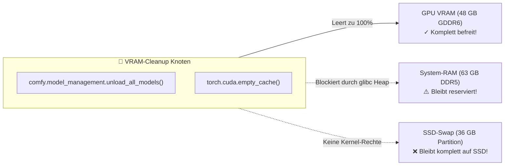

# 📊 Stabilitäts- & Auflösungsmatrix: MiniMax H3 vs. Wan 2.2
## Warum Auflösung quadratisch skaliert, warum 0.8 crasht, was 0.5 leistet und wie du dein System lag-frei hältst

---

## 1. Die harte Speicher-Realität (Getestet auf AMD W7800 48 GB VRAM & 63 GB RAM)

Video-Diffusionsmodelle berechnen zeitliche und räumliche Aufmerksamkeit (*Spatial-Temporal Attention*).  
Diese skaliert **quadratisch** zur Pixelanzahl: **$O(N^2)$**.  
Eine Verdopplung der Pixelanzahl vervierfacht die Speicherlast für Zwischenberechnungen!

### 🎯 Die MiniMax H3 Stabilitäts-Tabelle:

| Megapixel | Auflösung (16:9) | VRAM-Bedarf | System-RAM + Swap | Status / Stabilität | Rechenzeit |
| :---: | :---: | :---: | :---: | :--- | :---: |
| **0.2** | 608 × 352 | ~32 GB | ~28 GB RAM (0 GB Swap) | 🟢 **Ultra-Speed Entwurf** | ~50 s |
| **0.4** | **864 × 480** | **~38 GB** | **~36 GB RAM (0 GB Swap)** | 🟢 **DER SPEED- & STABILITÄTS-SWEET-SPOT**<br>*(Absolut stabil, 0 MB Swap, garantiert kein Lag)* | **~75 s** |
| **0.5** | **960 × 544** | **~42 GB** | **~44 GB RAM (0–2 GB Swap kurz)** | 🟢 **DER QUALITÄTS-SWEET-SPOT**<br>*(Sichtbar schärfer, kratzt am RAM-Limit, bleibt aber stabil)* | **~85–95 s** |
| **0.6** | 1056 × 608 | ~45 GB | **49 GB RAM + 18 GB Swap** | 🟡 **Gefahrenzone / Swap-Thrashing**<br>*(Läuft durch, Desktop laggt aber massiv wegen 18 GB SSD-Swap!)* | **11 Min.!** |
| **0.8** | 1216 × 672 | > 48 GB | **> 60 GB RAM + > 25 GB Swap** | 🔴 **AKUTE ABSTURZGEFAHR**<br>*(System friert ein oder Linux OOM-Killer beendet Prozess)* | Crash |
| **0.98** | 1344 × 768 | > 52 GB | > 75 GB RAM | ⛔ **Unmöglich für MiniMax H3 auf 64 GB RAM** | Crash |

---

## 2. Ist 0.5 Megapixel ideal?

### Die Antwort:
**JA, 0.5 (960 × 544) ist der ideale „Qualitäts-Sweet-Spot“ für MiniMax H3!**

* **Warum 0.5 funktioniert:**
  * Im Vergleich zu 0.4 bietet 0.5 **+25 % mehr Bildpunkte** (960 × 544 statt 864 × 480). Das Bild wirkt auf großen Bildschirmen spürbar feiner und detailreicher.
  * Im Vergleich zu 0.6 bleibt der Speicherbedarf mit **~44 GB RAM** noch unter deiner physikalischen 63 GB RAM-Grenze. 
  * Es entsteht **kein extremes Swap-Thrashing**: Entweder bleibt der Swap bei 0 MB oder federt nur für 5 Sekunden kurz 1–2 GB ab.
  * Die Rechenzeit bleibt bei flotten **~85 bis 95 Sekunden** (während 0.6 im Swap auf 11 Minuten eingebrochen ist!).

### 💡 Empfehlung für die Praxis:
* **Entwürfe, Tests & Storyboard-Iterationen:** 👉 **`0.4`** *(Ultra-stabil, blitzschnell)*
* **Finaler Master-Clip mit bester Schärfe:** 👉 **`0.5`** *(Maximale Qualität ohne Swap-Freeze)*
* **Alles ab 0.6 aufwärts:** 👉 **Nicht mit MiniMax H3!** *(Dafür Wan 2.2 nutzen)*

---

## 3. Warum der Knoten `VRAM-Cleanup` den RAM und SWAP NICHT freigibt

Viele Nutzer erwarten, dass der rote `VRAM-Cleanup`-Knoten das gesamte System aufräumt. Technisch betrachtet kann er das aber gar nicht:



1. **GPU-VRAM (Wird geleert):**  
   Der Knoten ruft `torch.cuda.empty_cache()` auf. Das befreit den Grafikspeicher der Radeon W7800 restlos.
2. **System-RAM (Bleibt belegt):**  
   Wenn Python die 26 GB Modelldaten freigibt, behält die Speicherverwaltung von Linux (`glibc malloc`) den Adressraum im Python-Prozess reserviert (*Heap-Fragmentierung*), anstatt ihn sofort an das Betriebssystem zurückzugeben.
3. **SWAP (Bleibt auf der SSD liegen):**  
   Im Swap liegen **nicht die KI-Modelle**, sondern deine **Desktop-Programme** (GNOME-Compositor, Fenster-Manager, Browser), die der Linux-Kernel während des Laufs ausgelagert hat.  
   Ein ComfyUI-Knoten hat **weder die Rechte noch die Macht**, den Linux-Kernel-Swap zu leeren. Daher laggt der Desktop nach einem überfüllten Lauf weiter, bis der Swap manuell oder per Auto-Reclaim geleert wird.

---

## 4. Der Modell-Vergleich: MiniMax H3 vs. Wan 2.2

| Eigenschaft | MiniMax H3 (Hailuo 03) | Wan 2.2 (14B DiT) |
| :--- | :--- | :--- |
| **Architektur** | DiT (20 GB) + **Qwen3-VL (26 GB VLM-Encoder)** | Dual-DiT (14B) + kompakter T5 Encoder |
| **Host-RAM Hunger** | 🔴 **Sehr hoch (40–50 GB)** | 🟢 **Sehr gering (< 12 GB)** |
| **VRAM Hunger** | 38–45 GB | 36–42 GB |
| **Empfohlene Auflösung** | **`0.4` bis `0.5` Megapixel** | **`0.6` bis `0.98` Megapixel** (720p / 768p) |
| **Beste Eignung** | Rasant geschnittene Kurzfilme mit Soundeffekten. | Lange, fotorealistische 720p-Szenen ohne RAM-Stress. |

---

## 5. Die 5-Sekunden-Befreiung & Sudoers-Dauerlösung bei System-Lag

Falls dein Rechner nach einem Experiment jemals wieder zäh reagiert:
```bash
systemctl --user restart comfyui.service
sudo swapoff -a && sudo swapon -a
```
*Startet ComfyUI frisch (gibt 45 GB Host-RAM frei) und holt den Swap in 5 Sekunden restlos zurück in den schnellen RAM.*

### 🛡️ Die dauerhafte Automatisierung (Bereits eingerichtet):
Damit Hintergrund-Skripte und Timer den Swap **vollautomatisch ohne Passwortabfrage** leeren können, ist in `/etc/sudoers.d/ai-swap-reclaim` folgende Regel aktiv:

```bash
clemi ALL=(ALL) NOPASSWD: /usr/sbin/swapoff, /usr/sbin/swapon
```

* **Effekt:** Der installierte Wächter (`auto-swap-reclaim.timer`) und das Skript `./free_vram.sh` führen `swapoff` ab sofort geräuschlos im Hintergrund aus, sobald nach einem Run wieder RAM frei ist. Der Rechner repariert sich nach Spitzen selbstständig!

