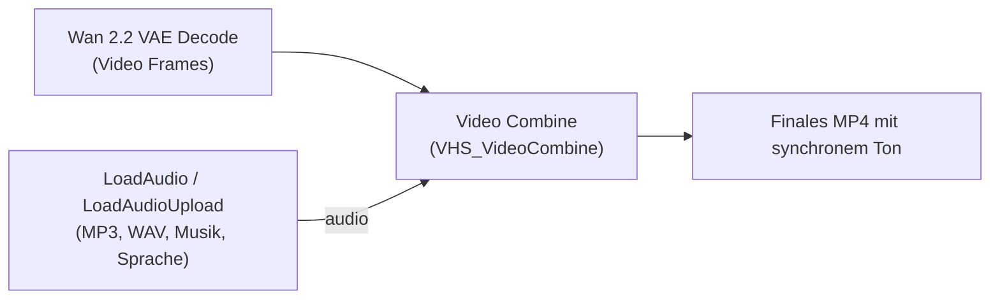

# Anleitung: Audio und Ton in KI-Videos integrieren (Wan 2.2, Flux & Co.)

## 1. Grundlagen: Warum hat MiniMax H3 Ton, Wan 2.2 aber nicht?

* **MiniMax H3 ist ein „Joint Audio-Video DiT“ (Omni-Modell):**  
  MiniMax wurde speziell dafür trainiert, während der Diffusionsberechnung sowohl Bild-Latents als auch Audio-Spektrogramm-Latents gleichzeitig zu erzeugen. Es besitzt ein eigenes Audio-VAE (`minimax_h3_audio_vae_fp32.safetensors`), das die Latents in eine 24-kHz-Stereotonspur decodiert.
* **Wan 2.1 / Wan 2.2, FLUX, CogVideoX, LTX-Video:**  
  Sind **reine Bild- und Video-Diffusionsmodelle**. Sie berechnen ausschließlich visuelle Bildpunkte (Pixel). Sie erzeugen von Natur aus **keine Audiospur**.

Um bei Wan 2.2 oder anderen Modellen Ton in das finale Video zu bekommen, gibt es drei praxiserprobte Wege:

---

## 2. Methode 1: Direktes Audio-Muxing in ComfyUI (Bereits installiert!)

Über die in deiner Umgebung installierte Erweiterung **`ComfyUI-VideoHelperSuite`** kannst du jede beliebige Audiodatei (Soundeffekt, Musik, KI-Sprache) direkt beim Speichern des Videos einbetten. ComfyUI nutzt intern FFmpeg, um Video und Audio synchron und ohne Qualitätsverlust in einer MP4-Datei zusammenzuführen.

### Diagramm des Workflows:



### Schritt-für-Schritt-Anleitung in ComfyUI:

1. **Audio-Ladeknoten hinzufügen:**  
   * Mache einen Doppelklick auf die freie Arbeitsfläche.
   * Suche nach **`LoadAudio`** oder **`LoadAudioUpload`** (Kategorie: `Video Helper Suite`).
2. **Audiodatei auswählen oder hochladen:**  
   * Bei `LoadAudio`: Wähle eine Datei aus deinem Eingabeordner (`ComfyUI/input/`).
   * Bei `LoadAudioUpload`: Klicke auf den Button und lade eine beliebige MP3-, WAV- oder AAC-Datei direkt über den Browser hoch.
3. **Mit dem Video-Knoten verbinden:**  
   * Suche in deinem Workflow den Knoten **`Video Combine`** (oder `VHS_VideoCombine`), an dem das Video erzeugt wird.
   * Verbinde den gelben Ausgang **`AUDIO`** des Audio-Ladeknotens mit dem optionalen Eingang **`audio`** des `Video Combine`-Knotens.
4. **Parameter einstellen:**  
   * **`frame_rate`:** Achte darauf, dass die Framerate (z. B. `16` FPS) mit deinem Wan-Workflow übereinstimmt.
   * Wenn das Audio länger als das Video ist, schneidet ComfyUI das Audio automatisch passend auf die Videolänge zu.
5. **Generieren:**  
   * Klicke auf *Queue Prompt*. Das generierte Video im Ordner `ComfyUI/output/` enthält nun die fertige Tonspur.

---

## 3. Methode 2: KI-generierter Sound (Video-to-Audio & Foley AI)

Wenn du kein vorgefertigtes Audio hast, sondern möchtest, dass eine KI das Video „sieht“ und automatisch passende Geräusche erzeugt:

### A. Video-to-Audio (Foley AI) mit `MMAudio`
* **Was es ist:** Ein hochmodernes Open-Source-Modell, das Bewegungen im Video analysiert (z. B. Schritte, schlagende Türen, Wind, Motorengeräusche, Explosionen) und exakt getimte Soundeffekte generiert.
* **ComfyUI Custom Node:** `ComfyUI-MMAudio` (kann über den ComfyUI-Manager installiert werden).
* **Vorteil:** Erfordert keine manuelle Suche nach Soundeffekten.

### B. Musik- und Ambient-Generierung mit Text-Prompts
* **Modelle:** `Stable Audio Open` oder `AudioLDM2`.
* **Funktionsweise:** Du gibst einen Prompt ein (z. B. *"dark cinematic battle music with heavy war drums and violin, 120 bpm"*), erhältst eine 10–30 Sekunden lange WAV-Datei und verbindest sie mit deinem Video.

### C. Sprachausgabe (Voiceover / Dialoge)
* **Open-Source:** `F5-TTS` oder `CosyVoice` (erzeugt extrem natürliche Stimmen direkt lokal).
* **Cloud-Alternative:** `ElevenLabs` (SOTA für emotionale Charakter-Stimmen).

---

## 4. Methode 3: Der professionelle Schnitt-Workflow (CapCut / DaVinci Resolve)

In der kommerziellen Film- und Content-Erstellung werden Wan 2.2 Clips stumm gerendert und anschließend in ein Schnittprogramm importiert:

1. **Kostenlose Programme:**  
   * **CapCut Desktop (Linux/Web/Windows):** Riesige integrierte Soundbibliothek, automatische Soundeffekt-Vorschläge, lizenzfreie Musik und Auto-Untertitel.
   * **DaVinci Resolve (Linux):** Studio-Standard mit der *Fairlight*-Audio-Engine für professionelles Sounddesign.
2. **Die 3 Audio-Ebenen für packende KI-Videos:**
   * **Ebene 1: Raum- und Atmosphärensound (Ambience):** Regen, Wind, Straßenlärm, Waldgeräusche (schafft Tiefe).
   * **Ebene 2: Geräuscheffekte (Foley & Hard SFX):** Schwertklingen, Schritte, Schläge, Whoosh-Übergänge.
   * **Ebene 3: Musik & Sprache:** Subtiler Score, der die Emotion der Szene trägt.

---

## 5. Schnelle Terminal-Befehle: Audio nachträglich mit FFmpeg anfügen

Wenn du ein bereits gerendertes Wan-Video schnell im Terminal mit einer MP3-Datei zusammenfügen willst, ohne ComfyUI neu zu starten:

### A. Video und Audio zusammenfügen (ohne Qualitätsverlust):
```bash
ffmpeg -i video.mp4 -i audio.mp3 -c:v copy -c:a aac -shortest output_mit_ton.mp4
```
* `-c:v copy`: Kopiert den Videostream direkt ohne Renderzeit in 0,5 Sekunden.
* `-shortest`: Beendet das Video, sobald das kürzere Element (Video oder Audio) vorbei ist.

### B. Kurzes Audio loopen (falls Video länger ist):
```bash
ffmpeg -stream_loop -1 -i audio.mp3 -i video.mp4 -c:v copy -c:a aac -shortest output_loop.mp4
```

### C. Lautstärke anpassen:
```bash
ffmpeg -i video.mp4 -i audio.mp3 -filter_complex "[1:a]volume=0.8[a]" -map 0:v -map "[a]" -c:v copy output.mp4
```
*(Setzt die Lautstärke der Tonspur auf 80 %).*

