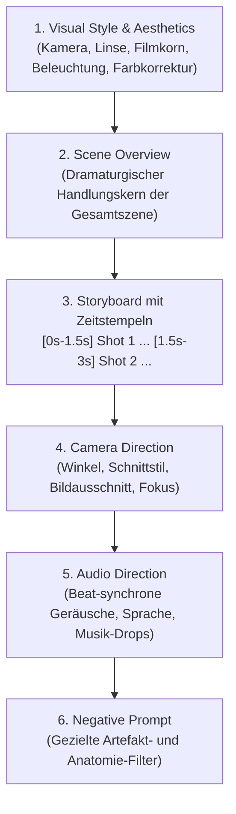

# 🎬 Regie- & Produktionsleitfaden (Gold-Standard): 15s-Kurzfilm „Die kleine Maus im Käseladen“
## Hochprofessionelles Video- & Audio-Prompting für MiniMax H3 (Hailuo 03)

> **Modell:** MiniMax H3 mit 8-Step Turbo LoRA  
> **Hardware:** AMD Radeon PRO W7800 (48 GB VRAM) | ROCm 6.4 | ComfyUI  
> **Format:** Hollywood Gold-Standard Prompting (Visual Style, Scene Overview, Timestamped Storyboard, Camera, Audio, Negative)  
> **Ziel:** 15 Sekunden zusammenhängende Filmhandlung, native synchrone Soundeffekte & Sprache, Renderzeit unter 90s pro Block.

---

## 📑 Inhaltsverzeichnis
1. [Die Anatomie des „Gold-Standard“-Promptings](#1-die-anatomie-des-gold-standard-promptings)
2. [Allgemeine Settings in ComfyUI (Speed- & Stabilitäts-Sweetspot)](#2-allgemeine-settings-in-comfyui-speed--stabilitäts-sweetspot)
3. [Kamera-, Licht- & Regie-Settings (Cinematography)](#3-kamera--licht--regie-settings-cinematography)
4. [Master-Prompt A: Der 5-Sekunden All-in-One Trailer (1 Durchlauf)](#4-master-prompt-a-der-5-sekunden-all-in-one-trailer-1-durchlauf)
5. [Master-Prompts B: Der vollständige 15-Sekunden-Film (3 Blöcke à 5 Sekunden)](#5-master-prompts-b-der-vollständige-15-sekunden-film-3-blöcke-à-5-sekunden)
   - [Block 1 (0s–5s): Das Betreten & Staunen (Ankunft)](#block-1-0s5s-das-betreten--staunen-ankunft)
   - [Block 2 (5s–10s): Die Auswahl & das Feilschen (Interaktion)](#block-2-5s10s-die-auswahl--das-feilschen-interaktion)
   - [Block 3 (10s–15s): Die Bezahlung & der Abgang (Happy End)](#block-3-10s15s-die-bezahlung--der-abgang-happy-end)
6. [Referenz-Beispiel C: Action-Trailer (Cyberpunk Rooftop Chase)](#6-referenz-beispiel-c-action-trailer-cyberpunk-rooftop-chase)
7. [Post-Production: 1-Klick Zusammenfügen mit FFmpeg](#7-post-production-1-klick-zusammenfügen-mit-ffmpeg)
8. [VRAM- & Speichermanagement](#8-vram--speichermanagement)

---

## 1. Die Anatomie des „Gold-Standard“-Promptings

Moderne High-End-Videomodelle wie **MiniMax H3** nutzen multimodale Groß-Sprachmodelle als Text-Encoder (**Qwen3-VL 32B**). Sie verstehen kein unstrukturiertes Keyword-Stakkato, sondern reagieren exakt auf Drehbuch-Instruktionen mit festen Abschnitten:



---

## 2. Allgemeine Settings in ComfyUI (Speed- & Stabilitäts-Sweetspot)

Um die Generierungszeit von 33 Minuten auf **unter 90 Sekunden pro Clip** zu senken, gelten folgende Settings:

| Parameter | Empfohlener Wert | Warum für dieses Projekt? |
| :--- | :---: | :--- |
| **Workflow-Datei** | `video_minimax_h3_t2v_amd.json` | Text-to-Video Workflow in `ComfyUI/user/default/workflows/`. |
| **`Enable Lightning / Turbo LoRA`** | **`true` (Aktiv)** | Nutzt das 8-Step Turbo-LoRA (`minimax_h3_fl2v_turbo_8step...`). |
| **`steps`** | **`8`** | Exakt abgestimmt auf das LoRA; berechnet den Clip in ca. 85 Sekunden. |
| **`cfg`** | **`1.0`** | **Zwingend bei Turbo!** Verhindert Farbverbrennungen und halbiert die Berechnungszeit. |
| **Auflösung (`Resolution`)** | **`768 × 512`** *(Querformat)*<br>oder **`512 × 768`** *(Hochformat / Social Media)* | **Der Hebel für Schnelligkeit:** Rendert doppelt so schnell wie 1080p bei hoher nativer Schärfe. |
| **`megapixels`** | **`0.4` (Speed) oder `0.5` (Qualität)** | **Der wichtigste Stabilitäts-Hebel:** `0.4` (864×480) für blitzschnelle Tests ohne Swap (75s). `0.5` (960×544) als Qualitäts-Sweet-Spot (85s). Bei `0.6` droht Swap-Lag; **bei `0.8+` akute Absturzgefahr!** *(Siehe [Stabilitätsmatrix](file:///home/clemi/Projekte/LLM/image-video-setup/SPEICHER_UND_AUFLOESUNG_MATRIX.md))*. |
| **`duration` (Dauer)** | **`5.0` Sekunden** | Ergibt bei 3 Blöcken exakt deinen **15-Sekunden-Film**. |
| **Sampler / Scheduler** | **`Euler` / `simple`** | Sauberer Farbverlauf und flüssige Bewegung. |

---

## 3. Kamera-, Licht- & Regie-Settings (Cinematography)

* **Optik & Linse:** `Anamorphic lens`, `35mm practical film photography style`, `shallow depth of field`.  
  *Wirkung:* Verleiht dem animierten Film den Look einer teuren Kinoproduktion mit weichem Bokeh im Hintergrund.
* **Perspektive (Point of View):** `Low-angle ground-level shot`.  
  *Wirkung:* Die Kamera bleibt auf Augenhöhe der kleinen Maus. Der rustikale Käseladen wirkt dadurch majestätisch, warm und riesig.
* **Beleuchtung & Atmosphäre:** `Post-rain dusk / golden hour`, `warm volumetric dust motes`, `restrained amber grading`.  
  *Wirkung:* Warmes, einfallendes Abendlicht durch das Schaufenster erzeugt eine nostalgische, wohlige Atmosphäre.
* **Schnittstil:** `Rapid cinematic cuts on musical beats, clean and hard cuts, no dissolves`.  
  *Wirkung:* Schnelle, dynamische Schnitte passend zum Rhythmus der Tonspur.

---

## 4. Master-Prompt A: Der 5-Sekunden All-in-One Trailer (1 Durchlauf)

*Wenn du eine kompakte, rasante 5-Sekunden-Fassung in einem einzigen Render-Durchlauf erzeugen möchtest (MiniMax schneidet alle 4 Shots und den Sound intern synchron zusammen):*

### Positive Prompt:
```text
Realistic live-action cinematic look, storybook movie trailer: 35mm practical film photography style, rustic gourmet cheese shop at golden hour dusk, anamorphic lens, shallow depth of field, natural fine film grain, warm volumetric dust motes, restrained amber grading for a premium feel, fluid natural character movement.

Scene overview: inside a warm sunlit rustic cheese shop, an adorable dressed mouse goes on an adventure to purchase the finest wedge of Swiss cheese, completing the transaction and departing happily. This is the charming storybook sequence of an animated short film trailer: delightful, whimsical and fluid.

Storyboard (each shot a separate scene, rapid cuts, all landing on the musical beats):
[0s-1.5s] Shot 1: low ground-angle shot: little brown mouse in a tiny green tweed vest pushes open the heavy wooden shop door, stepping inside onto polished floorboards, eyes wide in wonder.
[1.5s-2.5s] Shot 2: medium close-up: the mouse stands tall at the illuminated glass counter, whiskers twitching, pointing excitedly with its paw at a huge golden wheel of Swiss cheese.
[2.5s-4s] Shot 3: counter-level interaction: the mouse slides a tiny shiny copper coin across the wood, a gentle human hand slides back a neat triangular wedge wrapped in brown twine-tied paper.
[4s-5s] Shot 4: wide exit shot: the mouse proudly waddles out the front door into the sunny street, hugging the cheese package under its arm, waving a paw back in farewell.

Camera: each shot its own distinct cinematic angle, cuts clean and hard, subtle low-angle perspective emphasizing the tiny character, warm creamy background bokeh.

Audio: shop door bell chimes at 0s, soft paw pitter-patter, tiny excited mouse squeak at 2s, crisp metal coin clink on polished wood at 3s, paper crinkling, uplifting warm acoustic melody swelling at 4s, resolving warmly on the last 1s.
```

### Negative Prompt:
```text
human faces, realistic human characters, static, motionless, frozen, blurry, low resolution, ugly, distorted limbs, extra fingers, three ears, camera shake, glitch, subtitles, watermark, text
```

---

## 5. Master-Prompts B: Der vollständige 15-Sekunden-Film (3 Blöcke à 5 Sekunden)

Für den vollen 15-Sekunden-Film generierst du drei 5-Sekunden-Clips. Jeder Block folgt streng dem Gold-Standard:

---

### 🐭 Block 1 (0s–5s): Das Betreten & Staunen (Ankunft)

* **Dauer:** `5.0` s | **Auflösung:** `768 × 512` | **Steps:** `8` | **CFG:** `1.0`

```text
Realistic live-action cinematic look, storybook film style: 35mm practical film photography, cozy rustic gourmet cheese shop at golden hour dusk, anamorphic lens, shallow depth of field, natural film grain, warm volumetric dust motes, rich amber color grading.

Scene overview: a charming little mouse discovers and enters the magnificent rustic cheese shop for the first time.

Storyboard (each shot a separate scene, rapid cuts on the beats):
[0s-2.5s] Shot 1: low ground-angle shot: a tiny brown field mouse wearing a tailored green tweed vest and miniature leather backpack pushes open the heavy rustic wooden shop door, stepping inside onto polished floorboards.
[2.5s-5s] Shot 2: slow push-in medium shot: the mouse pauses, standing tall on its hind legs, gazing upward in absolute awe at towering wooden shelves filled with massive golden cheese wheels.

Camera: low ground-level tracking shot transitioning to gentle slow push-in, cuts clean and hard, warm creamy bokeh.

Audio: heavy wooden door creaks open, brass shop bell chimes ding-dong at 0s, soft rapid pitter-patter of tiny paws on wood, warm cozy room ambience with gentle orchestral hum swelling at 3s.

Negative:
human faces, realistic human characters, static, motionless, frozen, blurry, low resolution, ugly, distorted limbs, extra fingers, three ears, camera shake, glitch, subtitles, watermark, text
```

---

### 🐭 Block 2 (5s–10s): Die Auswahl & das Feilschen (Interaktion)

* **Dauer:** `5.0` s | **Auflösung:** `768 × 512` | **Steps:** `8` | **CFG:** `1.0`

```text
Realistic live-action cinematic look, storybook film style: 35mm practical film photography, warm glowing glass reflections, anamorphic lens, shallow depth of field, natural film grain, cozy amber lighting.

Scene overview: the mouse inspects the cheese counter and selects the ultimate piece of cheese to buy.

Storyboard (each shot a separate scene, rapid cuts on the beats):
[0s-2.5s] Shot 1: close-up shot: the mouse stands on its hind legs with both paws pressed against the clean glass display case, whiskers twitching rapidly, pointing enthusiastically at a huge glowing golden wheel of Swiss cheese with large holes.
[2.5s-5s] Shot 2: counter-level shot: the mouse climbs onto a little wooden stool at the counter, placing a shiny miniature copper coin onto the polished wood and proudly sliding it forward with both paws.

Camera: medium close-up to sharp counter-level perspective, clean cut at 2.5s, sharp focus on twitching whiskers and shiny coin.

Audio: delighted high-pitched mouse squeak at 1s, soft tapping of little paws against glass, distinct metallic coin clink on polished wood at 3.5s, faint pleasant accordion tune in the background.

Negative:
human faces, realistic human characters, static, motionless, frozen, blurry, low resolution, ugly, distorted limbs, extra fingers, three ears, camera shake, glitch, subtitles, watermark, text
```

---

### 🐭 Block 3 (10s–15s): Die Bezahlung & der Abgang (Happy End)

* **Dauer:** `5.0` s | **Auflösung:** `768 × 512` | **Steps:** `8` | **CFG:** `1.0`

```text
Realistic live-action cinematic look, storybook film style: 35mm practical film photography, golden hour sunset rim light, anamorphic lens, warm lens flare, natural film grain, heartwarming finish.

Scene overview: the friendly grocer hands over the wrapped cheese, and the triumphant mouse journeys home.

Storyboard (each shot a separate scene, rapid cuts on the beats):
[0s-2.5s] Shot 1: detail shot: a friendly shopkeeper's large gentle human hand slides over a triangular wedge of cheese, neatly wrapped in rustic brown paper and tied with a twine bow; the mouse receives the package with grateful paws.
[2.5s-5s] Shot 2: wide establishing exit shot: looking from inside toward the sunny open doorway, the mouse waddles proudly onto the cobblestone street, hugging the cheese package under its arm, waving back in farewell before scurrying into the sunset.

Camera: close interaction shot cutting cleanly at 2.5s into a wide backlit exit framing, golden hour rim lighting, holding on the final silhouette.

Audio: crinkling brown wrapping paper, a warm friendly chuckle at 1s murmuring 'Here you go, little friend!', shop door bell jingling at 3s, tiny cheerful mouse giggle, uplifting acoustic guitar melody swelling warmly and resolving at 5s.

Negative:
human faces, realistic human characters, static, motionless, frozen, blurry, low resolution, ugly, distorted limbs, extra fingers, three ears, camera shake, glitch, subtitles, watermark, text
```

---

## 6. Referenz-Beispiel C: Action-Trailer (Cyberpunk Rooftop Chase)

*Für High-Speed Action, Verfolgungsjagden und düstere Sci-Fi-Trailer eignet sich diese Vorlage:*

```text
Realistic live-action cinematic look, action movie trailer: practical film photography style, a post-rain dusk metropolis, anamorphic lens, shallow depth of field, film grain, city volumetric fog, flying-car traffic between the towers, restrained grading for a premium feel, powerful natural movement.

Scene overview: at dusk on a cluster of skyscrapers, the protagonist is being chased, sprinting and leaping across rooftops, jumping from one building's roof to the next with pursuers closing in behind. This is the escape sequence of an action movie trailer: every leap is life-or-death, thrilling and fluid.

Storyboard (each shot a separate scene, rapid cuts, all landing on the musical beats):
[0s-1.5s] Shot 1: high side angle: the protagonist sprinting at the roof edge, pursuers appearing in the rooftop doorway behind him, wind catching his coat.
[1s-2.5s] Shot 2: the protagonist leaps across the gap between buildings, body stretching mid-air, towers and flying-car light trails behind him, a slight slow-motion feel.
[2.5s-4s] Shot 3: he lands, rolls and rises, low-angle shot, tower shadows and fog behind him, he keeps running.
[4s-5s] Shot 4: freeze: the instant he hits the edge of the next roof and launches into the jump, silhouette, holding.

Camera: each shot its own angle, cuts clean and hard, no dissolves, a slight frame jitter on the jumps.

Audio: wind, rapid footsteps, city ambience, low score underneath, an accent hit on each leap, the score bursting at 4s, closing the last 1s.

Negative:
human faces, realistic human characters, static, motionless, frozen, blurry, low resolution, ugly, distorted limbs, extra fingers, three ears, camera shake, glitch, subtitles, watermark, text
```

---

## 7. Post-Production: 1-Klick Zusammenfügen mit FFmpeg

Nachdem die 3 Blöcke in `ComfyUI/output/video/` gerendert wurden (z. B. als `MiniMax_H3_00001_.mp4`, `00002_`, `00003_`):

### 1. In das Ausgabeverzeichnis wechseln:
```bash
cd /home/clemi/Projekte/LLM/image-video-setup/ComfyUI/output/video
```

### 2. Schnittliste `maus_film.txt` anlegen:
```bash
cat << 'EOF' > maus_film.txt
file 'MiniMax_H3_00001_.mp4'
file 'MiniMax_H3_00002_.mp4'
file 'MiniMax_H3_00003_.mp4'
EOF
```

### 3. Verlustfrei zusammenfügen (dauert ca. 1 Sekunde):
```bash
ffmpeg -f concat -safe 0 -i maus_film.txt -c copy maus_kaese_kurzfilm_15s.mp4
```

* `-c copy`: Kein Re-Encoding, kein Qualitätsverlust. Das finale Video ist exakt **15 Sekunden** lang und enthält Bild und Ton aller 3 Blöcke nahtlos hintereinander.

---

## 8. VRAM- & Speichermanagement

* Während des Renderns der 3 Blöcke schiebt ComfyUI den 26 GB Text-Encoder nach jeder Prompt-Konditionierung kurz in den Host-RAM und holt ihn für den nächsten Block zurück.
* **Nach dem 3. Block:** Einmalig im WebUI oben rechts auf **`Unload Models`** klicken, um die 26 GB Text-Encoder-Gewichte sauber aus dem System-RAM zu entladen.
