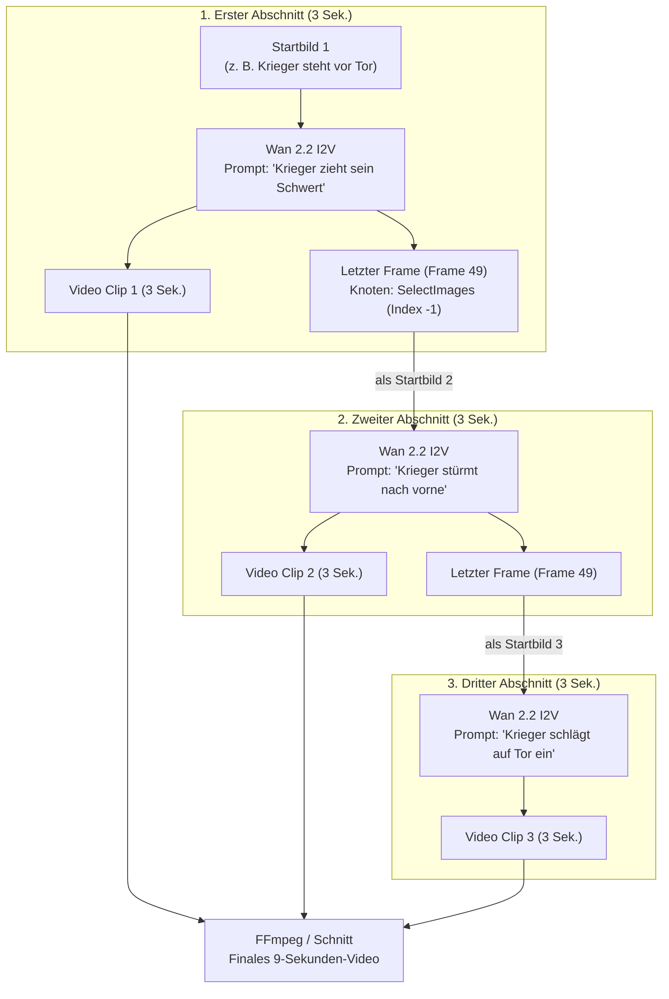

# Anleitung: Längere KI-Videos erstellen (10s, 30s, 1 Minute+)

## 1. Das technische Kernproblem: Warum sind KI-Videos standardmäßig nur 3 bis 5 Sekunden lang?

Die Diffusionsmodelle (Wan 2.1, Wan 2.2, MiniMax H3, CogVideoX) verarbeiten Videos als ein dreidimensionales Datenvolumen:  
**Höhe $\times$ Breite $\times$ Anzahl der Frames ($H \times W \times F$)**.

* **Quadratische Skalierung der Selbstaufmerksamkeit (Self-Attention):**  
  Die Transformer-Attention vergleicht jedes Pixel mit jedem anderen Pixel über alle Zeitschritte hinweg. Der Rechen- und Speicheraufwand wächst **quadratisch** ($O(N^2)$) mit der Anzahl der Frames:
  * **3 Sekunden (49 Frames bei 16 FPS):**  
    Passt perfekt in die 48 GB VRAM deiner AMD Radeon PRO W7800. Die Berechnung läuft blitzschnell mit voller GPU-Bandbreite (~14 Sekunden pro Schritt im Turbo-Modus).
  * **5 Sekunden (81 Frames bei 16 FPS):**  
    Erfordert bereits fast das Dreifache an Zwischenspeicher (Activation Memory). Die Grenze des ungeteilten VRAMs wird erreicht, ComfyUI lagert Schichten aus und die Schrittzeit steigt auf ~68 Sekunden.
  * **15 bis 30 Sekunden an einem Stück:**  
    Würde mehrere hundert Gigabyte VRAM erfordern und selbst Supercomputer zum Absturz bringen.

**Die Lösung:** Längere Videos werden in der professionellen KI-Videoproduktion **modular** erzeugt und nahtlos zusammengefügt.

---

## 2. Methode 1: Der „Last-Frame Chaining“-Workflow (Nahtlose Fortsetzung)

Das ist die Königsdisziplin der KI-Regie: Ein Video wird in Abschnitten von 3 bis 4 Sekunden generiert, wobei der **allerletzte Frame** des ersten Clips als **Startbild** für den nächsten Clip verwendet wird.

### Diagramm des Workflows:



### Schritt-für-Schritt-Anleitung in ComfyUI:

1. **Clip 1 generieren:**  
   * Lade dein Startbild in den `Wan 2.2 I2V`-Workflow.
   * Setze die Dauer auf **`3.0` Sekunden** (bzw. 49 Frames bei 16 FPS).
   * Generiere Clip 1.
2. **Den letzten Frame extrahieren:**  
   * Füge den Knoten **`SelectImages`** (aus der Kategorie `Video Helper Suite` / `image_latent`) hinzu.
   * Verbinde den Bild-Ausgang des Wan VAE Decode-Knotens mit dem Eingang `images` von `SelectImages`.
   * Setze im Knoten den Parameter **`indexes`** auf **`-1`** (in Python bedeutet `-1` immer das letzte Element).
3. **Clip 2 vorbereiten:**  
   * Leite den Ausgang dieses Knotens in den `start_image`-Eingang für den nächsten Durchlauf.
   * Passe den Prompt für die **Folgehandlung** an (z. B. von *"steht ruhig"* zu *"rennt entschlossen los"*).
4. **Ergebnis:**  
   Da Clip 2 pixelgenau mit der Pose, Kleidung, Beleuchtung und Kameraführung von Clip 1 beginnt, entsteht ein fließender Übergang ohne Artefakte oder Springen.

---

## 3. Methode 2: Klassische Filmsprache & Storyboard-Montage (Der beste Weg für 30s+)

Ein packendes 30-Sekunden-Video im Kino oder in der Werbung ist **nie ein ungeschnittener One-Take**. Ein starres 30-Sekunden-Video ohne Schnitt wirkt schnell langweilig.

Stattdessen erzeugst du **5 bis 7 unterschiedliche Kamera-Einstellungen**, die jeweils 3 bis 5 Sekunden dauern:

| Shot | Dauer | Kamera-Einstellung | Prompt-Beispiel | Zweck |
| :---: | :---: | :--- | :--- | :--- |
| **1** | 3s | **Totale (Establishing Shot)** | *"Weite Landschaft, alte Burgruine im Nebel, tiefe Wolken"* | Verortet die Szene |
| **2** | 3s | **Halbtotale (Medium Shot)** | *"Ritter in glänzender Rüstung schreitet durch den Schlamm"* | Führt die Figur ein |
| **3** | 2s | **Nahaufnahme (Close-Up)** | *"Dramatische Nahaufnahme des Gesichts, Regentropfen, fokussierter Blick"* | Erzeugt Emotion |
| **4** | 4s | **Action / Dynamik** | *"Kamera folgt dem gezogenen Schwert im schnellen Schwung"* | Baut Spannung auf |
| **5** | 3s | **Gegenschuss / Froschperspektive**| *"Großes Burgtor splittert unter dem wuchtigen Hieb"* | Zeigt die Wirkung |

* **Produktionsvorteil:**  
  Jeder Shot wird mit Wan 2.2 Turbo in **nur 60–90 Sekunden** gerendert. Du kannst fehlerhafte Shots einzeln neu generieren, ohne das gesamte Video von vorne rechnen zu müssen.
* **Fertigstellung:**  
  Wirf die 5 MP4-Dateien in ein Schnittprogramm (z. B. **CapCut** oder **DaVinci Resolve**), lege Musik und Soundeffekte darunter – fertig ist der kinoreife Kurzfilm!

---

## 4. Methode 3: Frame-Interpolation & Slow-Motion (Verdopplung der Laufzeit)

Mit KI-basierter Frame-Interpolation kannst du Clips künstlich verlängern, ohne neue Inhalte generieren zu müssen:

1. **Framerate verdoppeln oder vervierfachen:**  
   * Der Wan-Clip wird standardmäßig mit **16 FPS** gerendert.
   * Mit dem RIFE-Algorithmus (z. B. über `ComfyUI-Frame-Interpolation`) wird die Framerate auf **64 FPS** interpoliert (die KI errechnet 3 neue Zwischenbilder pro Frame).
2. **Slow-Motion Verlängerung:**  
   * Wenn ein 64-FPS-Video mit standardmäßigen 24 FPS abgespielt wird, läuft es mit **37,5 % Geschwindigkeit** in butterweicher Zeitlupe.
   * **Ergebnis:** Aus einem 4-Sekunden-Clip wird ein **10,6 Sekunden langer** cineastischer Zeitlupen-Clip.

---

## 5. Schnelles Aneinanderhängen von Clips mit FFmpeg

Wenn du Clips direkt im Terminal verlustfrei hintereinanderhängen willst:

### A. Liste der Clips erstellen:
Erstelle eine Textdatei `clips.txt`:
```text
file 'clip1.mp4'
file 'clip2.mp4'
file 'clip3.mp4'
```

### B. Nahtlos zusammenfügen (in 1 Sekunde ohne Re-Encoding):
```bash
ffmpeg -f concat -safe 0 -i clips.txt -c copy langes_video.mp4
```

### C. Mit weicher Überblendung (Crossfade / Dissolve 0.5s):
```bash
ffmpeg -i clip1.mp4 -i clip2.mp4 -filter_complex "[0:v][1:v]xfade=transition=fade:duration=0.5:offset=2.5[v]" -map "[v]" crossfade_video.mp4
```
*(Blendet ab Sekunde 2.5 für eine halbe Sekunde weich in Clip 2 über).*

