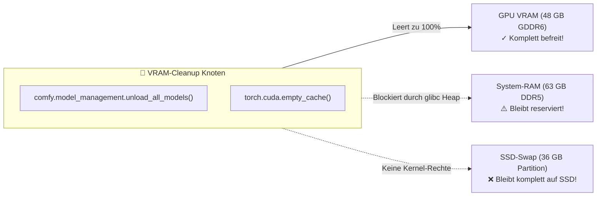

# 📊 Speicher-, Auflösungs- & Workflow-Leitfaden (ComfyUI)
## MiniMax H3 vs. Wan 2.2, VRAM/RAM/Swap-Verhalten, Auflösungs-Limits & Entlade-Regeln

> **Hardware:** AMD Radeon PRO W7800 (48 GB VRAM, Netto ~45,0 GiB) | 64 GB RAM | 36 GB NVMe-Swap | Ubuntu Linux (ROCm 6.4)  
> **Ziel:** Maximale Bild-/Video-Schärfe bei 100 % Systemstabilität ohne Desktop-Ruckeln oder Freezes.

---

## 📑 Inhaltsverzeichnis
1. [Wann Modelle entladen werden sollten (und wann NICHT)](#1-wann-modelle-entladen-werden-sollten-und-wann-nicht)
2. [Die 5 Methoden zur Speicherverwaltung](#2-die-5-methoden-zur-speicherverwaltung)
3. [Das Swap-Phänomen: Warum das System trotz VRAM-Freigabe laggt](#3-das-swap-phänomen-warum-das-system-trotz-vram-freigabe-laggt)
4. [Stabilitäts- & Auflösungsmatrix: MiniMax H3 vs. Wan 2.2](#4-stabilitäts--auflösungsmatrix-minimax-h3-vs-wan-22)
5. [Warum der ComfyUI-Knoten `VRAM-Cleanup` den RAM & Swap NICHT leert](#5-warum-der-comfyui-knoten-vram-cleanup-den-ram--swap-nicht-leert)
6. [Vergleich der High-End Video-Setups (H3 vs. Wan 2.2)](#6-vergleich-der-high-end-video-setups-h3-vs-wan-22)

---

## 1. Wann Modelle entladen werden sollten (und wann NICHT)

### 1.1 Wichtigste Grundregel:
* **Wenn du durchgängig mit EINEM Modell arbeitest, das in 48 GB passt:**  
  👉 **VRAM-Cleanup ist VÖLLIG UNNÖTIG (und verlangsamt die Arbeit massiv)!**  
  * **Betrifft:** **Wan 2.1**, **Wan 2.2**, **FLUX.1 [dev]**, **SDXL** und **Qwen-Image-2.1**.  
  * **Speicher-Realität:** Jedes dieser Modelle belegt zwischen 6 GB (SDXL) und maximal 38 GB (Wan 2.2). Auf der W7800 (48 GB) passen alle Komponenten dauerhaft zu **100 % in den VRAM**.  
  * **Großer Vorteil:** Wenn kein Cleanup-Knoten die Gewichte löscht, verbleiben sie im VRAM. Folge-Generierungen (neue Prompts, Seeds, Posen) starten in **0 Sekunden** ohne Ladezeit!  
  * **Nachteil von unnötigem Cleanup:** Jedes Mal müssen gigantische Modelldateien (24–38 GB) neu von der SSD geladen werden – das kostet bei jedem Klick 20 bis 60 Sekunden sinnlose Wartezeit.

### 1.2 Wann VRAM-Cleanup tatsächlich sinnvoll & notwendig ist:
1. **Nur bei einem MODELL-WECHSEL:**  
   * Wenn du von Wan zu einem anderen Modell (z. B. **MiniMax H3** oder **FLUX.1 [dev]**) wechselst, um alten Speicherplatz restlos freizugeben.
2. **Bei MiniMax H3 nach dem Bildladen (Konditionierung):**  
   * MiniMax nutzt den gigantischen 26 GB Text- & Bild-Encoder (`qwen3vl_32b`). Zusammen mit dem 20 GB DiT übersteigt das Gesamtgewicht die 48 GB VRAM.  
   * Der 26 GB VLM-Encoder muss nach der Bildanalyse weichen, um Platz für den Diffusionskern zu machen.  
   * Nach Fertigstellung des Videos sollte MiniMax entladen werden, damit der Encoder nicht dauerhaft im System-RAM verweilt.

---

## 2. Die 5 Methoden zur Speicherverwaltung

| Methode | Wo / Wie | Wann nutzen? | Was wird befreit? |
| :--- | :--- | :--- | :--- |
| **Weg 1: `Unload Models` Button** | ComfyUI Web-Menü oben rechts | Bei Modellwechsel im Browser | VRAM + System-RAM (Modellgewichte) |
| **Weg 2: `VRAM-Cleanup` Knoten** | Am Ende von MiniMax H3 Workflows | Automatisiert im Workflow | GPU-VRAM (PyTorch Cache) |
| **Weg 3: `--cache-ram 4 16`** | Startparameter in `scripts/start_comfyui.sh` | Permanent aktiv | Begrenzt Host-RAM-Caching auf max. 16 GB |
| **Weg 4: `./scripts/restart_comfyui.sh`** | Terminal-Befehl | Bei Hängern / frischem Reset | 100 % VRAM + Python-Host-RAM |
| **Weg 5: `./scripts/free_vram.sh`** | Terminal-Befehl | All-in-One Bereinigung | VRAM + RAM-Caches + SSD-Swap |

---

## 3. Das Swap-Phänomen: Warum das System trotz VRAM-Freigabe laggt

### Die Ursache:
1. MiniMax H3 benötigt kurzzeitig extrem viel **System-RAM (Host-Arbeitsspeicher)**, um Text-Encoder, DiT und Audio-VAE zu handhaben.
2. Um einen OOM-Absturz zu verhindern, lagert der Linux-Kernel während des Runs **Desktop-Programme** (GNOME, Browser-Tabs, Compositor) auf die **SSD in den Swap** aus.
3. Nach der Generierung holt Linux diese Daten **nicht automatisch** zurück! Jede Fensteraktion erfordert langsame SSD-Page-Faults.
4. Zudem hält der Python-Prozess von ComfyUI im Host-RAM oft noch 15–20 GB reservierten Heap-Speicher.

### Die 2-Schritt-Sofortlösung (5 Sekunden):
1. **ComfyUI-Dienst neustarten** (gibt Host-RAM frei):
   ```bash
   systemctl --user restart comfyui.service
   # oder: ./scripts/restart_comfyui.sh
   ```
2. **Den Swap zurück in den schnellen RAM holen**:
   ```bash
   sudo swapoff -a && sudo swapon -a
   ```

### 🛡️ Vollautomatisierung: Die Sudoers-Regel
In `/etc/sudoers.d/ai-swap-reclaim` ist hinterlegt:
```bash
clemi ALL=(ALL) NOPASSWD: /usr/sbin/swapoff, /usr/sbin/swapon
```
Damit leert das Skriterium `scripts/free_vram.sh` und der Hintergrund-Wächter den Swap ohne Passwortabfrage.

---

## 4. Stabilitäts- & Auflösungsmatrix: MiniMax H3 vs. Wan 2.2

Video-Diffusionsmodelle berechnen räumlich-zeitliche Aufmerksamkeit (*Spatial-Temporal Attention*). Diese skaliert **quadratisch** zur Pixelanzahl ($O(N^2)$).

### 🎯 Die MiniMax H3 Stabilitäts-Tabelle:

| Megapixel | Auflösung (16:9) | VRAM-Bedarf | System-RAM + Swap | Status / Stabilität | Rechenzeit |
| :---: | :---: | :---: | :---: | :--- | :---: |
| **0.2** | 608 × 352 | ~32 GB | ~28 GB RAM (0 GB Swap) | 🟢 **Ultra-Speed Entwurf** | ~50 s |
| **0.4** | **864 × 480** | **~38 GB** | **~36 GB RAM (0 GB Swap)** | 🟢 **DER SPEED- & STABILITÄTS-SWEET-SPOT**<br>*(Absolut stabil, 0 MB Swap, garantiert kein Lag)* | **~75 s** |
| **0.5** | **960 × 544** | **~42 GB** | **~44 GB RAM (0–2 GB Swap kurz)** | 🟢 **DER QUALITÄTS-SWEET-SPOT**<br>*(Sichtbar schärfer, kratzt am RAM-Limit, bleibt aber stabil)* | **~85–95 s** |
| **0.6** | 1056 × 608 | ~45 GB | **49 GB RAM + 18 GB Swap** | 🟡 **Gefahrenzone / Swap-Thrashing**<br>*(Läuft durch, Desktop laggt massiv wegen 18 GB SSD-Swap!)* | **11 Min.!** |
| **0.8** | 1216 × 672 | > 48 GB | **> 60 GB RAM + > 25 GB Swap** | 🔴 **AKUTE ABSTURZGEFAHR**<br>*(System friert ein oder Linux OOM-Killer beendet Prozess)* | Crash |
| **0.98** | 1344 × 768 | > 52 GB | > 75 GB RAM | ⛔ **Unmöglich für MiniMax H3 auf 64 GB RAM** | Crash |

### 💡 Praxis-Empfehlungen:
* **Entwürfe & Iterationen:** 👉 **`0.4` (864 × 480)** *(Ultra-stabil, schnell)*
* **Finaler Master-Clip mit bester Schärfe:** 👉 **`0.5` (960 × 544)** *(+25 % mehr Bildpunkte, stabil unter 63 GB RAM)*
* **Alles ab 0.6 aufwärts:** 👉 **Nicht mit MiniMax H3!** *(Dafür Wan 2.2 nutzen)*

---

## 5. Warum der ComfyUI-Knoten `VRAM-Cleanup` den RAM & Swap NICHT leert



* **GPU-VRAM:** `torch.cuda.empty_cache()` leert den Grafikspeicher zu 100 %.
* **System-RAM:** Python/glibc gibt allozierte Heap-Blöcke erst beim Prozessende an das Betriebssystem zurück.
* **SSD-Swap:** Gehört dem Linux-Kernel; kann aus dem unprivilegierten Python-Prozess nicht gesteuert werden.

---

## 6. Vergleich der High-End Video-Setups (H3 vs. Wan 2.2)

| Vergleich | **H3 Setup 1 – empfohlen** | **H3 Setup 2 – Qualitätsmodus** | **Wan 2.2 A14B – Gegenspieler** |
| :--- | :--- | :--- | :--- |
| **Modell** | `fl2va_int8_convrot` | `fl2va_int8_convrot` | T2V/I2V-A14B |
| **Diffuser** | **Full INT8 ConvRot, 34 GB** | **Full INT8 ConvRot, 34 GB** | 14B MoE, High-/Low-Noise-Expert |
| **Text Encoder** | **Qwen3-VL-32B INT8** | **Qwen3-VL-32B BF16** (CPU/RAM) | UMT5-XXL (FP8/FP16) |
| **VAE** | Video **FP16** + Audio FP32 | Video **FP16** + Audio FP32 | Wan VAE |
| **VRAM-Bedarf** | **Sehr gut passend** | Diffuser passt, Encoder RAM | 48 GB mit Offload; offiziell 80 GB Single-GPU |
| **RAM-Bedarf** | **Gut** | **Hoch**; BF16-Encoder ~51,5 GB | Mittel–hoch bei Offload |
| **Native Audio** | **✅ Stereo Audio integriert** | **✅ Stereo Audio integriert** | Standard **❌ Kein natives Audio** |
| **Prompt-/VLM-Verständnis** | ⭐⭐⭐⭐⭐− | **⭐⭐⭐⭐⭐** | ⭐⭐⭐⭐½ |
| **Bild-/Referenztreue** | ⭐⭐⭐⭐⭐− | **⭐⭐⭐⭐⭐** | ⭐⭐⭐⭐⭐ |
| **Bewegungsqualität** | ⭐⭐⭐⭐½ | ⭐⭐⭐⭐½ | **⭐⭐⭐⭐⭐** |
| **Kameraführung/Cinematic**| ⭐⭐⭐⭐½ | ⭐⭐⭐⭐½ | **⭐⭐⭐⭐⭐** |
| **Audio/SFX/Musik** | **⭐⭐⭐⭐⭐** | **⭐⭐⭐⭐⭐** | ⭐⭐ |
| **Detailqualität** | ⭐⭐⭐⭐⭐− | **⭐⭐⭐⭐⭐** | ⭐⭐⭐⭐⭐ |
| **Geschwindigkeit (W7800)** | ⭐⭐⭐⭐ | ⭐⭐⭐ | ⭐⭐⭐ |
| **AMD/ROCm-Fit** | **⭐⭐⭐⭐** | ⭐⭐⭐½ | ⭐⭐⭐½ |
| **Gesamt für deine Hardware** | **🏆 9,3/10** | **🏆 9,5/10** | **8,9/10** |
| **Einsatzempfehlung** | **✅ Standardbetrieb** | **✅ Schwierige/Referenz-Shots** | **✅ Wenn Bewegung Priorität hat** |
