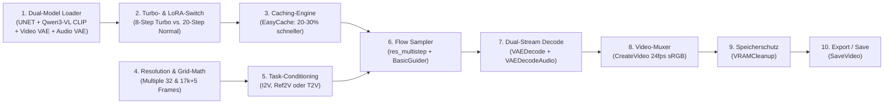

# 📐 Blaupause: Der ideale MiniMax H3 Workflow
## Schritt-für-Schritt-Anleitung zum Aufbau eines produktionsreifen ComfyUI-Workflows

> **Ziel:** Ein stabiler, speichersicherer und modular erweiterbarer MiniMax H3 Workflow, der native Audio-Video-Generierung beherrscht, ohne VRAM-Lecks oder Abstürze zu verursachen.

---

## 🧭 Die 10 Kernbausteine eines idealen H3-Workflows

Ein professioneller MiniMax H3 Workflow besteht nicht einfach aus einem Sampler und zwei Loadern. Wegen der **gemeinsamen AV-Latent-Architektur** (gleichzeitige Berechnung von Bild und Stereoton) und dem **Flow-Matching** benötigt H3 eine präzise Kette aus 10 Komponenten:



---

### Schritt 1: Das Vierer-Loader-Gespann (Modelle laden)
MiniMax H3 berechnet Video und Ton in einem gemeinsamen latenten Raum. Du benötigst zwingend vier Loader:
1. **`UNETLoader`**: Lädt die DiT-Gewichte (`minimax_h3_fl2va_pruned_int8_convrot.safetensors` oder `ref2va`).
2. **`CLIPLoader`**: Lädt den multimodalen Text-Encoder (`qwen3vl_32b_minimax_h3_int8_convrot.safetensors`).  
   ⚠️ **Wichtig:** Der Typ muss im Dropdown auf **`minimax`** gestellt werden!
3. **`VAELoader` (Video)**: `minimax_h3_video_vae_int8_convrot.safetensors` (16-Kanal Video-Latent).
4. **`VAELoader` (Audio)**: `minimax_h3_audio_vae_fp32.safetensors` (32-Kanal 40Hz Audio-Latent).

---

### Schritt 2: Der Schalter für Turbo- vs. Normalmodus
Um ohne Umbauten zwischen schnellem Testen und finaler Qualität zu wechseln:
* **`LoraLoaderModelOnly`**: Lädt `minimax_h3_fl2v_turbo_8step_v1.0_comfyui_bf16.safetensors` mit Stärke `1.0`.
* **Zwei `ComfySwitchNode`-Knoten**:
  * Schalter 1 (Model): Wählt zwischen Base-UNET und LoRA-gepatchtem Modell.
  * Schalter 2 (Steps): Wählt zwischen **8 Steps** (Turbo) und **20 Steps** (Normal).
* Gesteuert über einen einzigen Schalter (`PrimitiveBoolean`: *Enable Turbo*).

---

### Schritt 3: Die Caching-Beschleunigung (`EasyCache`)
* Setze den Knoten **`EasyCache`** direkt hinter den Modellausgang des Schalters.
* **Einstellungen:**
  * `reuse_threshold`: `0.20`
  * `start_percent`: `0.15` (Start nach 15 % der Schritte)
  * `end_percent`: `0.95` (Stoppt vor den letzten 5 % für scharfe Details)
* **Effekt:** Spart 20–30 % Rechenzeit pro Clip ohne sichtbaren Schärfeverlust.

---

### Schritt 4: Auflösungs- & Zeit-Mathematik (Das 17k+5 Gitter)
MiniMax H3 akzeptiert keine beliebigen Bild- oder Frame-Größen:
1. **Auflösung (`ResolutionSelector`):**  
   Breite und Höhe müssen zwingend **Vielfache von 32** sein.  
   *Empfehlung für W7800:* 0.4 MP (`864 × 480`) für blitzschnelle Generierung; 0.5 MP (`960 × 544`) für Top-Qualität.
2. **Frame-Zahl (`ComfyMathExpression`):**  
   MiniMax rechnet intern in 17er-Blöcken mit 5 Startframes ($17k + 5$).  
   Formel im Knoten:
   ```text
   max(5, round(a * 24)) + (5 - (max(5, round(a * 24)) % 17)) % 17
   ```
   Bei Eingabe von `5.0` Sekunden berechnet die Formel exakt **124 Frames** (bei 24 fps).

---

### Schritt 5: Das Task-Conditioning (T2V, I2V oder Ref2V)
Je nach Aufgabe verbindest du den passenden Konditionierungs-Knoten:
* **Für Text-to-Video / Image-to-Video:**  
  Knoten **`MiniMaxH3ImageToVideo`**.  
  Nimmt Prompt, `width`, `height`, `length` und optional `first_frame` (Startbild) und `last_frame` (Zielbild).
* **Für Reference-to-Video (Charakter-Treue):**  
  Knoten **`MiniMaxH3ReferenceToVideo`**.  
  Nimmt `ref_images.ref_image_0`. Im Prompt muss zwingend das Tag `<Picture 1>` referenziert werden!

---

### Schritt 6: Sampling & Guiding (Flow-Matching)
* **`BasicGuider`**: Verbindet Modell und positives Conditioning.  
  ⚠️ **CFG-Regel:** Im Turbo-Modus muss CFG immer **`1.0`** sein (da das Modell distilled ist).
* **`BasicScheduler`**: Scheduler auf **`simple`** setzen.
* **`KSamplerSelect`**: Sampler auf **`res_multistep`** oder **`euler`**.
* **`SamplerCustomAdvanced`**: Verarbeitet das verschachtelte Audio-Video-Latent (`NestedTensor`).

---

### Schritt 7 & 8: Dual-Stream Decode & Video-Muxing
Weil Bild und Ton in einem gemeinsamen Latent stecken, zieht jeder VAE-Decoder automatisch seinen Teil heraus:
1. **`VAEDecode`**: Zieht den Videostream heraus und dekodiert ihn mit dem Video-VAE.
2. **`VAEDecodeAudio`**: Zieht den Audiostream heraus und dekodiert ihn mit dem Audio-VAE.
3. **`CreateVideo`**: Führt Video-Frames und Stereo-Audio mit `24.0 fps` in sRGB zusammen.

---

### Schritt 9: Der Speicherschutz (`VRAMCleanup`)
* Vor dem Speichern wird der Knoten **`VRAMCleanup`** (`offload_model: true`, `offload_cache: true`) zwischen `CreateVideo` und `SaveVideo` gesetzt.
* **Warum unverzichtbar?**  
  ComfyUI hält Diffusionsmodelle sonst im GPU-Speicher. Bei mehreren Szenen hintereinander summiert sich der Cache, bis das System in den Swap läuft oder der Linux-Treiber einfriert. `VRAMCleanup` leert den PyTorch-Cache zuverlässig nach jedem Clip.

---

### Schritt 10: Speichern & Post-Processing
* **`SaveVideo`**: Speichert die fertige MP4-Datei ab.
* **Optionales Post-Processing:**  
  Hinter `VAEDecode` kann direkt ein **`ImageUpscaleWithModelBatched`** gesetzt werden (z. B. mit `R-ESRGAN 4x+`), um den Clip vor dem Muxen von 480p auf 1080p oder 4K hochzuskalieren.

