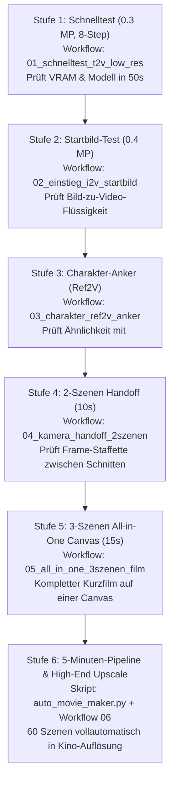
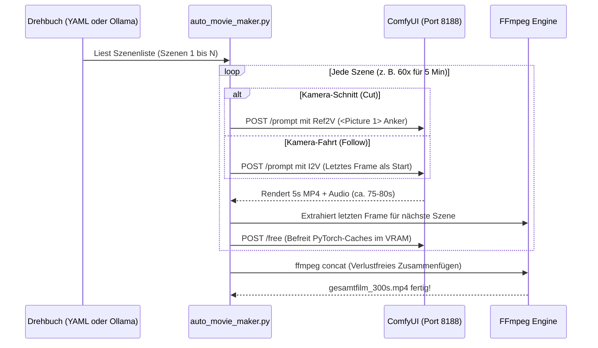

# 🎬 Master-Handbuch: MiniMax H3 Langfilm- & Charakter-Automatisierung
## Konsistente 5-Minuten-Filme, Stufen-Abarbeitungsplan & Toolings auf AMD Radeon PRO W7800 (48 GB VRAM)

> **Hardware-Basis:** AMD Radeon PRO W7800 (48 GB VRAM) | 64 GB Host-RAM | 32 GB NVMe-Swap | Ubuntu Linux | ROCm 6.4  
> **ComfyUI-Version:** v0.38.0 Native mit Zero-Copy Memory Management  
> **Workflows-Verzeichnis:** `ComfyUI/user/default/workflows/minimax_h3_stufen/` (Stufen 01 bis 06)

---

## ⚡ Kurzanleitung (Quickstart in 60 Sekunden)

### 1. Sofortiger 3-Szenen-Testlauf (Terminal)
Führe im Projektverzeichnis das 1-Klick-Testskript aus:
```bash
./scripts/run_test_movie.sh
```
Das Skript rendert vollautomatisch 3 zusammenhängende Szenen (15 Sekunden) mit dem Mäuse-Charakter und fügt sie per FFmpeg verlustfrei zu `output/test_movie_3scenes/gesamtfilm_15s.mp4` zusammen.

### 2. Das neue Stufen-Verzeichnis in ComfyUI
Unter `ComfyUI/user/default/workflows/minimax_h3_stufen/` findest du 6 nummerierte Workflows, sortiert von **super-einfach (wenig VRAM, maximale Geschwindigkeit)** bis **High-End (Kino-Qualität mit Upscaler & Langfilm)**:
1. `01_schnelltest_t2v_low_res.json` (Ultra-schneller Basis-Test, 0.3 MP, ~50s)
2. `02_einstieg_i2v_startbild.json` (Startbild flüssig vorwärts animieren)
3. `03_charakter_ref2v_anker.json` (Charakter-Treue mit `<Picture 1>` und EasyCache)
4. `04_kamera_handoff_2szenen.json` (2 Szenen mit automatischer Frame-Übergabe)
5. `05_all_in_one_3szenen_film.json` (Kompletter 15s-Film direkt auf der ComfyUI-Canvas)
6. `06_master_high_quality_upscale.json` (0.5 MP + EasyCache + R-ESRGAN Batched Upscaler)

---

## 🎯 Der 6-Stufen-Abarbeitungsplan (Von Test-Speed zu Kino-Qualität)

Wenn du ein neues Projekt startest, gehe schrittweise nach diesem Plan vor:



### Stufe 1: Basis-Funktionstest (Dauer: ~50 Sekunden)
* **Workflow:** `01_schnelltest_t2v_low_res.json`
* **Zweck:** Prüft mit niedriger Auflösung (0.3 MP = 736×416) im 8-Step Turbo-Modus, ob Text-Encoder, UNET, Audio-VAE und Video-VAE ohne Treiber-Timeout starten.
* **Ergebnis:** Du siehst nach unter 1 Minute den ersten animierten Clip mit Ton.

### Stufe 2: Bild-Animation (Dauer: ~75 Sekunden)
* **Workflow:** `02_einstieg_i2v_startbild.json`
* **Zweck:** Lädt dein Startbild (`first_frame`) in 0.4 MP (864×480). Prüft, wie MiniMax die Pose und das Setting in Bewegung versetzt.

### Stufe 3: Charakter-Konsistenz einrasten (Dauer: ~80 Sekunden)
* **Workflow:** `03_charakter_ref2v_anker.json`
* **Zweck:** Lädt dein Charakter-Masterbild (`character_master.png`) in `ref_image_0`.  
  *Wichtig:* Im Prompt muss stehen: `<Picture 1> is the detective in the brown coat...`.  
  Der Clip behält Kleidung, Gesichtszüge und Haare exakt bei. `EasyCache` spart dabei 25 % Rechenzeit.

### Stufe 4: Der erste Szenen-Übergang (Dauer: ~2,5 Minuten)
* **Workflow:** `04_kamera_handoff_2szenen.json`
* **Zweck:** Szene 1 generiert den Charakter. Der Knoten `ImageFromBatch` (`batch_index: -1`) greift das exakt letzte Frame ab und übergibt es an Szene 2. `ConcatenateVideo` verbindet beide zu einem 10s-Clip.

### Stufe 5: Der 15-Sekunden All-in-One Canvas-Film (Dauer: ~4 Minuten)
* **Workflow:** `05_all_in_one_3szenen_film.json`
* **Zweck:** Vollständiger 3-Szenen-Kurzfilm direkt in der ComfyUI-Weboberfläche. Enthält 2 Übergaben, Zwischen-VRAM-Cleanups und einen fertigen Video-Export.

### Stufe 6: Das 5-Minuten-Epos & High-End Upscaling
* **Zweck:** 60 Einzelszenen ($60 \times 5\text{s} = 300\text{s}$) vollautomatisch über [`scripts/auto_movie_maker.py`](file:///home/clemi/Projekte/LLM/image-video-setup/scripts/auto_movie_maker.py) abarbeiten lassen.  
* Optional danach mit `06_master_high_quality_upscale.json` über `ImageUpscaleWithModelBatched` und `R-ESRGAN 4x+` auf 1080p oder 4K hochskalieren.

---

## ⚙️ Wie funktioniert der Movie Maker unter der Haube?

Das Skript [`scripts/auto_movie_maker.py`](file:///home/clemi/Projekte/LLM/image-video-setup/scripts/auto_movie_maker.py) arbeitet als autonomer Regisseur zwischen deinem Drehbuch, ComfyUI und FFmpeg:



### Die Kernschritte im Code:
1. **Drehbuch-Auflösung:** Liest `story.yaml` ein. Wenn eine Textdatei übergeben wird, fragt das Skript das lokale LLM `qwen3.8-27b-q4` in Ollama nach einer Aufteilung in 5s-Blöcke.
2. **API-Injektion:** Sendet den jeweiligen MiniMax-Graphen an `http://127.0.0.1:8188/prompt`.
3. **Status-Polling:** Fragt alle 2 Sekunden den Endpunkt `/history/<prompt_id>` ab, bis der Clip fertig gerechnet ist.
4. **Frame-Extraktion:** Führt `ffmpeg -sseof -0.1 -i szene_N.mp4 -update 1 last_frame.png` aus, um den perfekten Übergabepunkt zu sichern.
5. **Speicherschutz:** Sendet nach jedem Durchlauf `POST /free` an ComfyUI, um Fragmentierung und Caches zu eliminieren.
6. **Lossless Concat:** Verbindet alle Szenen per FFmpeg ohne erneutes Enkodieren (`-c copy`).

---

## ❓ Ist das auch als reiner ComfyUI-Workflow umsetzbar?

**Ja!** Genau das leistet dein neuer Workflow **[`05_all_in_one_3szenen_film.json`](file:///home/clemi/Projekte/LLM/image-video-setup/ComfyUI/user/default/workflows/minimax_h3_stufen/05_all_in_one_3szenen_film.json)**:
* Szene 1 generiert Video 1.
* `GetVideoComponents` trennt Bild und Ton.
* Der native Knoten `ImageFromBatch` mit `batch_index = -1` schneidet das letzte Frame ab und leitet es in Szene 2 (`first_frame`).
* Szene 2 rendert Video 2.
* Wiederholt sich für Szene 3.
* `ConcatenateVideo` führt alle 3 Videos zusammen.

### Vor- und Nachteile im Vergleich:

| Kriterium | Reiner ComfyUI-Canvas Workflow | Externes Python-Skript (`auto_movie_maker.py`) |
| :--- | :--- | :--- |
| **Beste Eignung für:** | **Kurzfilme (15 bis 25 Sekunden, 3–5 Szenen)** | **Lange Filme (1 bis 10 Minuten, 12–120 Szenen)** |
| **Bedienung** | Visuell im Browser, Knoten per Maus verschieben | Einzeiler im Terminal (`./scripts/run_test_movie.sh`) |
| **Fehlertoleranz** | Bricht der Sampler in Szene 4 ab, bricht der gesamte Graph ab | Jede Szene wird sofort auf SSD gesichert; Wiederaufnahme möglich |
| **System-RAM** | 60 Szenen auf einer Canvas verbrauchen ca. 30 GB UI-Graph-RAM | Minimaler RAM-Verbrauch (lädt immer nur 1 Szene in die Queue) |
| **Text-Drehbuch** | Manuell in jeden String-Knoten tippen | Vollautomatisch via Ollama zerlegbar |

---

## 🧰 Die Spezial-Toolings & die neuen `_`-Workflows im Detail

In deinem Workflow-Ordner wurden 5 spezialisierte Workflows angelegt, die mit einem Unterstrich `_` beginnen, damit sie sofort an oberster Stelle stehen:
1. `_minimax_h3_prompt_enhancer.json` (4-Spur-Regie-Prompting für Bild & Ton)
2. `_minimax_h3_cache_und_preview.json` (EasyCache Beschleunigung & Sofort-Vorschau)
3. `_minimax_h3_batched_upscaler.json` (R-ESRGAN 4x+ Batched 1080p/4K-Upscaling)
4. `_minimax_h3_face_detailer_master.json` (Master-Keyframe-Gesichtsschärfung ohne Video-Flickern)
5. `_minimax_h3_sageattention_analyse.json` (Technische Analyse: SageAttention vs. AMD Native CK-SDPA)

---

### Bewertung der einzelnen Toolings für MiniMax H3 auf AMD ROCm:

| Tooling | Genutzt / Sinnvoll? | Fazit & Begründung |
| :--- | :--- | :--- |
| **Prompt Enhancer** | **JA, extrem sinnvoll** | Da H3 als Text-Encoder **Qwen3-VL 32B** nutzt, schalten detaillierte Prompts mit Kameraperspektiven, Lichtstilen und Tonanweisungen erst die volle Qualität frei. In `_minimax_h3_prompt_enhancer.json` modular aufgebaut. |
| **Cache (EasyCache)** | **JA, bereits aktiv** | Spart **20–30 % Rechenzeit** (ca. 25 Min. bei einem 5-Minuten-Film). Überspringt redundante Transformer-Berechnungen ohne sichtbaren Qualitätsverlust. |
| **Model Preview** | **Teilweise sinnvoll** | Standard-TAESD funktioniert **NICHT** (da H3 ein verschachteltes 16-Kanal-Video- und 32-Kanal-Audio-Latent nutzt). Stattdessen: Sampler-Step-Bar im UI + Keyframe-Schnellvorschau via `PreviewImage`. |
| **Face Detailer** | **NUR am Master-Bild!** | **Achtung vor der Flicker-Falle:** Wendet man FaceDetailer frame-weise auf fertige Videos an, flackert das Gesicht unerträglich. **Die Profi-Lösung:** Erst das Master-Charakterbild mit FaceDetailer schärfen, dann per Ref2V (`<Picture 1>`) einspeisen! |
| **Upscaler (R-ESRGAN)** | **JA, unverzichtbar** | Verhindert VRAM-Spitzen: 0.4 MP Basis-Render in 75s generieren, dann mit `ImageUpscaleWithModelBatched` (`R-ESRGAN 4x+.pth`) in 16er-Batches auf 1080p hochskalieren. |
| **Sage Attention** | **NEIN (Auf AMD nicht nutzbar!)** | Im Quellcode von `comfyui-kjnodes` ist ein hardcodierter CUDA-Check (`if _cuda_archs is None: raise RuntimeError`). SageAttention läuft nur auf NVIDIA Hopper/Ada. Auf AMD ROCm 6.4 ist bereits natives **Composable Kernel (CK) SDPA** aktiv, das optimal performt. |

---

## ⚡ LoRAs: Turbo vs. Normal-Modus

| Parameter | Turbo-Modus (Distilled LoRA) | Normal-Modus (Full Diffusion) |
| :--- | :--- | :--- |
| **Schritte (`steps`)** | **8 Steps** (oder 4 Steps) | **20 – 30 Steps** |
| **CFG / Guidance** | **1.0** (Zwingend! Höheres CFG verbrennt Farben) | 2.5 – 4.0 |
| **Renderzeit (5s Clip)** | **ca. 75 – 85 Sekunden** | ca. 4 – 5 Minuten |
| **Renderzeit (5 Min Film)** | **ca. 80 Minuten** | ca. 4,5 Stunden |
| **Bilddynamik** | Schnelle, flüssige Aktionen | Ruhige, statische Posen |

### Empfohlene LoRAs nach Einsatzgebiet:
1. **Turbo & Speed:**
   * `minimax_h3_fl2v_turbo_8step_v1.0_comfyui_bf16.safetensors` *(Vorhanden)*: Universeller Standard für 8-Step I2V und T2V.
   * `minimax_h3_ref2v_turbo_4step_v0.1_comfyui_bf16.safetensors`: Ultraschnell für Ref2V (unter 50s pro Clip).
2. **Kameradynamik & Action:**
   * `minimax-h3_fl2v_8Step_motion_enhancer`: Verhindert Bewegungsunschärfe bei schnellen Schwenks.
3. **Figurenphysik:**
   * `H3_VBVR_Pro_attn_only`: Saubere Physik für Kleidung, Haare und weiche Bewegungen.

---

## 🛡️ Systemoptimierung: AMD Radeon PRO W7800 (48 GB VRAM)

* **Auflösungs-Sweet-Spot:** **0.4 MP (`864 × 480`)**. Benötigt nur ~21 GB VRAM, rendert in ~75s und schließt Swap-Thrashing zu 100 % aus.
* **ROCm Stabilitäts-Flags (in `start_comfyui.sh`):**
  * `export HSA_ENABLE_SDMA=0`: Verhindert Lastwechsel-Freezes bei PCIe-Bustransfers.
  * `--disable-pinned-memory --disable-async-offload`: Hält Gewichte als File-backed `mmap` im RAM und verhindert 19 GB Swap-Stau.
  * `--reserve-vram 3`: Schützt den Desktop-Monitor vor Hängern bei GPU-Volllast.

---

## 🚀 CLI-Bedienung: `auto_movie_maker.py` & Starter-Skripte

### Die wichtigsten Befehlszeilen-Flags im Überblick:

| Flag | Standardwert | Erklärung / Empfehlung |
| :--- | :--- | :--- |
| `--story` | *(erforderlich)* | Pfad zum Drehbuch (`.yaml`, `.json` oder Freitext `.txt` via Ollama). |
| `--character` | `detective_portrait.png` | Pfad zum Master-Porträt der Hauptfigur für Ref2V (`<Picture 1>`). |
| `--output` | `output/auto_movie` | Zielordner für Einzelszenen und den finalen zusammengesetzten Film. |
| `--width` / `--height` | `864` / `480` | Native Render-Auflösung (0.4 MP, Widescreen 16:9). |
| `--duration` | `5.0` | Dauer pro Szene in Sekunden (5.0s = 120 Frames bei 24 fps). |
| `--steps` | `4` (Turbo) | Diffusions-Schritte (4 = High-Speed, 6–8 = Balanced, 20 = No-Turbo). |
| `--upscale` | *deaktiviert* | Aktiviert `R-ESRGAN 4x+ Batched` direkt in der Pipeline für 1080p Full HD. |
| `--no-turbo` | *deaktiviert* | Deaktiviert das Turbo-LoRA und berechnet volle 20–30 Diffusion-Steps. |
| `--offload-between-scenes` | `False` | Hält das 32B-Modell zwischen Szenen warm im VRAM (spart 40–60s Ladezeit pro Szene). |

### Qualität vs. Geschwindigkeit (Die 3 Preset-Kombinationen):

1. **Pre-Vis / Draft-Modus (Maximales Tempo, ~45–55s pro 5s Clip):**
   ```bash
   python3 scripts/auto_movie_maker.py --story configs/krimi_intro_30s.yaml --steps 4
   ```
2. **Produktions-Modus (Ausgewogene Details & Schärfe, ~70–80s pro Clip):**
   ```bash
   python3 scripts/auto_movie_maker.py --story configs/krimi_intro_30s.yaml --steps 8
   ```
3. **Kino-Modus (Beste Bildqualität auf 1080p, ~95–110s pro Clip):**
   ```bash
   python3 scripts/auto_movie_maker.py --story configs/krimi_intro_30s.yaml --steps 8 --upscale
   ```

### 30-Sekunden Krimi-Intro (6 Szenen) starten:
```bash
./scripts/run_krimi_intro.sh
# Oder direkt mit 1080p Upscaling:
./scripts/run_krimi_intro.sh --upscale
```

