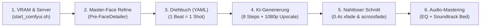

# 🎬 Kompakter Leitfaden: Maximale Videoqualität & Perfekter Workflow
> **System:** AMD Radeon PRO W7800 (48 GB VRAM, ROCm 6.4) | **Engine:** MiniMax H3 (32B) + R-ESRGAN + FFmpeg

---

## 🧭 Der 6-Schritte-Workflow auf einen Blick



---

## 💻 Alle Befehle nacheinander ausführen

### Schritt 1: ComfyUI Server im Hintergrund starten (falls nicht aktiv)
Startet den Server mit geschütztem Desktop-VRAM (`--reserve-vram 3`), deaktivertem Swap-Thrashing und AMD ROCm Stabilitäts-Flags:

```bash
cd /home/clemi/Projekte/LLM/image-video-setup
./scripts/start_comfyui.sh &
```

*Prüfen, ob der Server bereit ist (Status 200 OK):*
```bash
curl -s http://127.0.0.1:8188/system_stats | grep -o '"vram_free":[0-9]*'
```

---

### Schritt 2: Master-Charaktere vorab veredeln (Kein Video-Flickern!)
> [!IMPORTANT]
> **Niemals FaceDetailer auf das fertige Video anwenden!** Das würde 1440 Einzelbilder separat bearbeiten und extremes Gesichtsflackern (*Flicker*) erzeugen. Schärfen Sie stattdessen das Ausgangsbild **einmalig vor Drehstart** auf 4K-Mikroschärfe. MiniMax H3 überträgt diese scharfe DNA flackerfrei auf alle Frames.

1. Legen Sie Ihre Rohbilder ab:
   - `ComfyUI/input/detective_raw.png`
   - `ComfyUI/input/elena_raw.png`
2. Öffnen Sie `http://127.0.0.1:8188` und laden Sie den Workflow `_minimax_h3_face_detailer_master.json`.
3. Rendern Sie die Porträts einmalig mit Node 102 (`FaceDetailer`, Denoise 0.35).
4. Verlinken Sie die geschärften Master-Bilder:
   ```bash
   ln -sf 'YOTTEA-KREA-PRO (21).png' ComfyUI/input/detective_cross.png
   ln -sf T345KT05NWV2K1T38NJFWZCNY0.png ComfyUI/input/elena_vance.png
   ```

---

### Schritt 3: Drehbuch prüfen (Regie-Regel: 1 Beat = 1 Shot)
Für ruhige, physikalisch saubere Bewegungen ohne morphing Gliedmaßen erhält jede 5-Sekunden-Szene exakt **eine einzige klare Handlung**.

*Drehbuch ansehen oder anpassen:*
```bash
cat configs/krimi_story_1min_2personen.yaml
```

*Regie-Schlüssel für 100% Identität:*
- Jede Szene mit Gesichtsfokus nutzt `type: ref2v`.
- Jede Szene enthält hinter `<Picture 1>` dieselbe Kern-DNA:  
  `<Picture 1> Detective Cross, a 45-year-old rugged investigator with weathered stubble, sharp blue eyes, worn dark trenchcoat and charcoal fedora.`

---

### Schritt 4: Filmproduktion starten (8 Steps + 1080p R-ESRGAN Upscaler)
Dieser Befehl führt die gesamte Pipeline vollautomatisch aus:
- **8 Steps:** Verdoppelt die Diffusions-Schritte (gestochen scharfe Augen, Finger, Wassertropfen).
- **--upscale:** Skaliert intern in 16er-Batches via R-ESRGAN 4x+ auf **1920 × 1080 Full HD**.
- **VRAM-Warmstart:** 32B-Modell bleibt gepinnt (Spart ~8–10 Minuten Wartezeit).
- **Weiche Blenden:** Nutzt standardmäßig 0,4s `xfade` und `acrossfade`.

```bash
./scripts/run_1min_movie.sh --upscale
```

*(Alternativ: Ohne Upscaler für schnellen 480p-Test: `./scripts/run_1min_movie.sh`)*

---

### Schritt 5: (Optional) Bestehende Szenen manuell mit Kino-Crossfade verbinden
Haben Sie bereits Einzelclips gerendert und möchten Sie nachträglich mit weichen 0,4s-Blenden und Audio-Highpass verbinden:

```bash
python3 -c "
from scripts.auto_movie_maker import concatenate_scenes
import glob
clips = sorted(glob.glob('output/krimi_1min_2personen/szene_*.mp4'))
concatenate_scenes(clips, 'output/krimi_1min_2personen/gesamtfilm_60s_kino.mp4', smooth=True, fade_dur=0.4)
"
```

---

### Schritt 6: Audio veredeln (Film-Noir Musikbett hinzumischen)
MiniMax H3 liefert atmosphärische Geräusche (Regen, Klicks, Schritte). Ein dezenter Musik-Soundtrack im Hintergrund bindet alle Szenen zusammen und überdeckt jedes Restrauschen:

```bash
ffmpeg -y \
  -i output/krimi_1min_2personen/gesamtfilm_60s.mp4 \
  -i ComfyUI/input/soundtrack.mp3 \
  -filter_complex "[1:a]volume=0.22[bg];[0:a][bg]amix=inputs=2:duration=first[aout]" \
  -map 0:v -map "[aout]" \
  -c:v copy -c:a aac -b:a 192k \
  output/krimi_1min_2personen/gesamtfilm_60s_FINAL_MASTER.mp4
```

---

### Schritt 7: Web- & Streaming-Optimierung (Faststart)
Verschiebt den MP4-Header an den Anfang der Datei, damit das Video auf Smartphones, Web-Playern und TVs sofort ohne Puffer-Verzögerung abspielt:

```bash
ffmpeg -y \
  -i output/krimi_1min_2personen/gesamtfilm_60s_FINAL_MASTER.mp4 \
  -movflags +faststart \
  -c copy \
  output/krimi_1min_2personen/film_krimi_1min_web_ready.mp4
```

---

## 📊 Qualitäts-Checkliste vor dem Export

| Kontrollpunkt | Erreicht? | Technische Vorgabe |
| :--- | :---: | :--- |
| **Auflösung** | ✅ | **1920 × 1080 Full HD** (via `--upscale`) |
| **Sampling** | ✅ | **8 Steps** (Sweet Spot für feine Texturen) |
| **Gesichtsdetails** | ✅ | **Pre-FaceDetailer** auf Masterbild angewandt |
| **Übergänge** | ✅ | **0,4s xfade & acrossfade** (kein Ruckeln/Knacken) |
| **Tonkulisse** | ✅ | **75Hz Highpass** + dezent gemischtes Musikbett |
| **Streaming** | ✅ | **Faststart-Flag** aktiv für verzögerungsfreie Wiedergabe |

