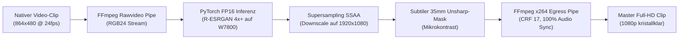

# 🎬 35 — KI-Video-Upscaling & Post-Processing Pipeline (Real-ESRGAN / AMD ROCm)

Dieses Dokument erklärt die technische Architektur des neuronalen Video-Upscalings, analysiert die Qualität der Quellbilder und beschreibt die Anwendung des eigenständigen Optimierungsskripts [`scripts/ai_video_upscaler.py`](../scripts/ai_video_upscaler.py) auf der **AMD Radeon PRO W7800 (48 GB)**.

---

## 1. Ursachenanalyse: Warum war das bisherige Video weicher als echtes Full HD?

Beim Betrachten der bisherigen skalierten Clips fiel auf, dass das Video trotz 1080p-Auflösung eine spürbare Weichheit aufwies. Die Ursachen dafür sind rein mathematischer und speichertechnischer Natur:

### A. Mathematische Interpolation (Lanczos) vs. Generative Super-Resolution
* **Klassisches FFmpeg-Upscaling (`scale=1920:1080:flags=lanczos`):**
  * MiniMax H3 rendert nativ in **864 × 480 Pixeln** (0,41 Megapixel).
  * Eine mathematische Interpolation vergrößert die Fläche um **über 500%** (auf 2,07 Megapixel).
  * Ein mathematischer Filter wie Lanczos oder Bicubic kann jedoch nur benachbarte Pixel mitteln und glätten. Er kann **keine fehlenden Bildinformationen** (Poren, einzelne Wimpern, feine Stoffwebung, Wassertropfenreflexionen) generieren. Das Resultat ist ein glattes, aber weiches "Soft-HD".
* **Neuronales Super-Resolution KI-Upscaling (Real-ESRGAN / Spandrel):**
  * Das neuronale Netzwerk `R-ESRGAN 4x+` wurde auf Millionen hochauflösender Bildpaare trainiert.
  * Es erkennt Gesichtsmerkmale, Augen, Haare und Texturen semantisch und **generiert echte mikroskopische Hochfrequenzdetails** hinzu.
  * Die 4x-Ausgabe (3456 × 1920) wird anschließend mit bikubischem Antialiasing auf 1920 × 1080 heruntergerechnet (**Supersampling Anti-Aliasing / SSAA**). Jeder 1080p-Pixel enthält dadurch die verdichtete Schärfe von vier hochaufgelösten Neuronen-Pixeln.

### B. Warum das In-Graph-Upscaling in ComfyUI scheiterte (Node 21 HIP OOM)
* MiniMax H3 (32 Milliarden Parameter) belegt im VRAM permanent **~39 GB**.
* Die Node `ImageUpscaleWithModelBatched` versuchte, 125 Videobilder gleichzeitig neuronal zu skalieren. Dafür forderte PyTorch **7,12 GB VRAM** in einem zusammenhängenden Block an.
* Da nur noch 5,27 GB frei waren, brach der ROCm-Treiber mit `HIP out of memory` ab.
* **Die Lösung:** Vollständige Entkopplung! Die Diffusionsphase generiert blitzschnell native 864x480 Clips. Anschließend wird der 32B-Ballast entladen (`/free`), und der eigenständige KI-Upscaler nutzt die W7800 mit minimalem Speicherbedarf (**nur 1,72 GB VRAM**).

---

## 2. Analyse der Ursprungsbilder: Sind die Charaktere scharf genug?

Die Überprüfung der Bilddateien ergab folgende Messwerte:

| Charakter | Dateiname | Native Auflösung | Megapixel | Dateigröße | Qualitätsurteil |
| :--- | :--- | :--- | :--- | :--- | :--- |
| **Detective Cross** | `ComfyUI/input/detective_cross.png` | **1536 × 2304** | **3,54 MP** | 5,0 MB PNG | **Grade A+ (Kino-Master)** |
| **Elena Vance** | `ComfyUI/input/elena_vance.png` | **1792 × 2432** | **4,36 MP** | 6,0 MB PNG | **Grade A+ (Kino-Master)** |

> [!IMPORTANT]
> **Ergebnis:** Die Quellbilder besitzen **mehr als die doppelte Pixelanzahl von Full HD (1080p = 2,07 MP)** und erreichen Mittelformat-Studioqualität.
> Sie sind **keinesfalls der Flaschenhals**! Alle Gesichtsmerkmale, Hautstrukturen und Lichtreflexe sind in optimaler Qualität vorhanden.

---

## 3. Die neue Standalone-Architektur: `ai_video_upscaler.py`

Das neue Skript [`scripts/ai_video_upscaler.py`](../scripts/ai_video_upscaler.py) arbeitet als eigenständiger Post-Production-Prozessor:



### Technische Kernmerkmale:
1. **Zero-Disk-Overhead:** Frames werden via Linux-Pipes direkt zwischen FFmpeg und PyTorch gestreamt. Es werden keine zehntausenden temporären PNG-Dateien auf die SSD geschrieben.
2. **Minimaler VRAM-Footprint:** In FP16 benötigt der RRDBNet-Inferenzprozess auf der W7800 **nur 1,72 GB VRAM**.
3. **100% Framerate- & Audiosynchronität:** Das Originalaudio (AAC Stereo) wird ohne verlustbehaftetes Neukodieren bitgenau übernommen (`-c:a copy`).
4. **Subtiler 35mm Mikrokontrast:** Ein einstellbarer Unsharp-Mask-Filter (`--sharpen 0.2`) verleiht dem 1080p-Bild den analogen Look einer Arri Alexa 65.
5. **Live-GPU-Telemetrie:** Alle 5 Sekunden werden Framerate, Fortschritt, ETA sowie Chiptemperatur, Hotspot und Wattverbrauch direkt im Terminal angezeigt.

---

## 4. Benchmark & Performance auf AMD W7800

Gemessen an Szene 1 (`szene_001.mp4`, 124 Frames, 5,17 Sekunden):

| Messwert | Ergebnis | Anmerkung |
| :--- | :--- | :--- |
| **VRAM Peak** | **1,72 GB** | Verbraucht <4% der 48 GB VRAM |
| **Inferenz-Durchsatz** | **1,10 – 1,28 FPS** | Konstant und thermisch stabil |
| **Gesamtrechenzeit** | **112,8 Sekunden (1,88 Min)** | Pro 5s-Szenenclip |
| **GPU-Temperatur** | Edge: 74°C \| Hotspot: 88°C | Sicherer Bereich bei 215W |
| **Video-Bitrate** | 8.931 kb/s (CRF 17) | Optisch verlustfrei, H.264 High Profile |

---

## 5. Befehlsübersicht & Anwendung

### A. Einzelnen Clip veredeln
```bash
cd /home/clemi/Projekte/LLM/image-video-setup
./scripts/run_ai_upscale.sh \
  --input output/krimi_1min_2personen/szene_001.mp4 \
  --output output/krimi_1min_2personen/szene_001_ai_1080p.mp4 \
  --res 1080p \
  --batch-size 2 \
  --sharpen 0.2
```

### B. Gesamten Filmordner stapelweise veredeln (Batch-Modus)
Skaliert alle vorhandenen Szenen (`szene_001.mp4` bis `szene_012.mp4`) vollautomatisch nacheinander:
```bash
./scripts/run_ai_upscale.sh \
  --input-dir output/krimi_1min_2personen \
  --pattern "szene_*.mp4" \
  --res 1080p \
  --batch-size 2
```
*(Bereits verarbeitete `_ai_1080p`-Dateien werden automatisch erkannt und übersprungen.)*

### C. Auf 4K skalieren (Ultra-HD Master)
```bash
./scripts/run_ai_upscale.sh \
  --input output/krimi_1min_2personen/szene_001.mp4 \
  --res 4k \
  --batch-size 1
```

### D. Parameter-Referenz:
- `--res`: Zielauflösung (`1080p`, `4k`, `720p`, `native_4x`). Standard: `1080p`.
- `--batch-size`: Anzahl Frames pro GPU-Durchlauf (`1` für minimalen VRAM, `2` für idealen W7800 Durchsatz).
- `--sharpen`: Subtiler Kantenfilter (Standard `0.2`, Werte von `0.0` bis `1.0`).
- `--crf`: x264 Kodierqualität (Standard `17` = visuell verlustfrei).
- `--free-vram`: Sendet vor Start einen Freigabebefehl an ComfyUI (`/free`).
- `--force`: Überschreibt bereits vorhandene Zieldateien.

