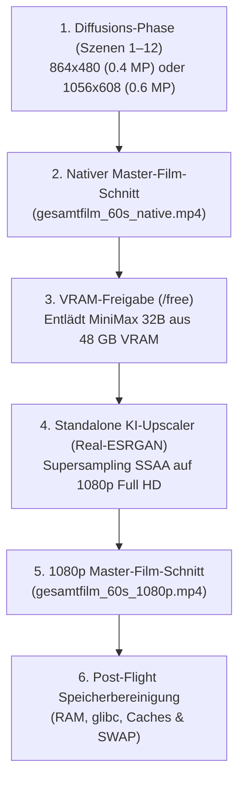

# 🎬 36 — Film-Regie, Story-Flow, Automatisches KI-Upscaling, Production-Log & SWAP-Reclaim

Dieses Dokument beschreibt die vier zentralen Verbesserungen der automatisierten Langfilm-Engine [`auto_movie_maker.py`](../scripts/auto_movie_maker.py) und [`run_1min_movie.sh`](../scripts/run_1min_movie.sh):

---

## 1. Film-Regie & Story-Flow (Kein hektischer Charakter-Switch mehr)

### Warum wechselten die Charaktere zuvor ständig hin und her?
Im ursprünglichen Drehbuch (`krimi_story_1min_2personen.yaml`) wechselte jede einzelne 5-Sekunden-Szene abwechselnd zwischen Detective Cross und Elena Vance (Cross $\rightarrow$ Tresor $\rightarrow$ Elena $\rightarrow$ Cross $\rightarrow$ Elena $\rightarrow$ Two-Shot $\rightarrow$ Elena $\rightarrow$ Cross $\rightarrow$ Elena ...).
Bei 12 Szenen à 5 Sekunden führte dieser "Ping-Pong-Schnitt" zu einem unruhigen, zerstückelten Seherlebnis.

### Die Lösung: 3-Akt-Sequenz-Dramaturgie ([`configs/krimi_story_1min_kino_flow.yaml`](../configs/krimi_story_1min_kino_flow.yaml))
Statt alle 5 Sekunden die Person zu wechseln, ist der 60-Sekunden-Film nun in drei geschlossene 20-Sekunden-Erzählblöcke unterteilt:

```
[0:00 - 0:20 | Akt 1: 20s] ────────► [0:20 - 0:40 | Akt 2: 20s] ────────► [0:40 - 1:00 | Akt 3: 20s]
  Fokus: DETECTIVE CROSS               Fokus: KONFRONTATION                 Fokus: DIE FLUCHT & FINALE
  - Ankunft Penthouse-Foyer             - Elena Vance am Tresor              - Fang des Kristalls (Cross)
  - Spurensuche (I2V Handoff)          - Two-Shot Duell (Beide im Bild)     - Sturm auf Terrasse (Elena)
  - Tresor-Entdeckung                  - Verhandlung & Dialog               - Sprung in Häuserschlucht
  - Zielerfassung mit Revolver         - Finte: Kristallwurf (I2V)          - Epilog an Brüstung (Cross)
```

**Ergebnis:** Jeder Charakter erhält Zeit zu atmen, Bewegungen bleiben räumlich logisch und der Film fühlt sich wie ein echter Kinofilm an.

---

## 2. Nahtlose Pipeline: Automatisches KI-Upscaling am Ende des Skripts

Zuvor musste das neuronale KI-Upscaling separat manuell gestartet werden. Nun ist die gesamte Signalkette in [`auto_movie_maker.py`](../scripts/auto_movie_maker.py) vollautomatisch verknüpft:



Wird `--upscale` an [`scripts/run_1min_movie.sh`](../scripts/run_1min_movie.sh) übergeben, generiert die Engine erst alle 12 Szenen, entlädt die 32B-Gewichte und veredelt anschließend alle Clips verlustfrei zu einem fertigen 1080p Full-HD Film – in einem einzigen Aufruf!

---

## 3. Lückenloses Terminal- & Problem-Logging (`production.log`)

Im Ausgabeverzeichnis jedes Filmprojekts (z. B. `output/krimi_1min_kino_flow/`) wird ab sofort eine persistente Logdatei erstellt:
* **Pfad:** `output/.../production.log`
* **Inhalt:**
  * Komplette Terminal-Ausgaben (ohne störende ANSI-Farbcodes)
  * Fortschritt, Frame-Zeiten, Durchsatz und GPU-Telemetrie (Temperatur, Hotspot, Watt)
  * Alle ComfyUI-Node-Wechsel
  * **Am Dateiende:** Eine dedizierte Zusammenfassungs-Box aller aufgetretenen Warnungen, Fehlermeldungen, Timeouts oder Speicherprobleme:
    ```
    ==================================================================
     📋 ZUSAMMENFASSUNG: WARNUNGEN & PROBLEME
    ==================================================================
     ✅ Keine Warnungen oder Fehler während der Produktion aufgetreten!
    ==================================================================
    ```

---

## 4. Ursache & Behebung des System-Stockens (SWAP-Thrashing)

### Warum stockte das Betriebssystem nach Fertigstellung des Films?
1. **Linux SWAP-Verhalten:** Wenn MiniMax H3 (32B) und PyTorch große Tensoren im RAM anfordern, lagert der Linux-Kernel inaktive Desktop-Prozesse (GNOME-Shell, Browser-Tabs, Hintergrundprogramme) in den Swap-Speicher auf der NVMe/SSD aus.
2. **Das Problem:** Selbst wenn nach Filmende wieder 45+ GB RAM frei sind, holt Linux ausgelagerte Prozesse **nicht** von selbst zurück! Beim nächsten Klick auf den Desktop muss jedes Programm zäh von der Festplatte gelesen werden ("Swap-In Thrashing"), was zu Sekundenlangen Rucklern führt.
3. **glibc Heap-Fragmentierung:** Der Linux C-Speicherallokator (`glibc`) behält freigegebenen Speicher im virtuellen Adressraum des Prozesses, solange `malloc_trim(0)` nicht explizit aufgerufen wird.

### Die automatische Behebung in `cleanup_system_ram_and_swap()`:
Am Ende jedes Film-Laufs führt die Pipeline nun vollautomatisch folgende 4 Schritte aus:
1. **`libc.malloc_trim(0)` & `gc.collect()`:** Gibt ungenutzte Heaps sofort an den Kernel zurück.
2. **`sync`:** Flusht alle gepufferten Schreibdaten sofort auf die SSD, damit keine I/O-Warteschlangen blockieren.
3. **Automatischer SWAP-Reclaim:** Erkennt, ob mehr als 50 MB Swap belegt sind, und schiebt alle Daten via `swapoff -a && swapon -a` mit voller NVMe-Geschwindigkeit zurück in den freien 48 GB physischen RAM.
4. **Caches leeren:** Führt [`scripts/free_vram.sh`](../scripts/free_vram.sh) aus, sodass das gesamte System sofort wieder absolut butterweich läuft.

---

## 5. Anwendung & Befehl

Starte den Film mit 0.6 Megapixel (+55% native Schärfe), automatischem KI-Upscaling und voller Systembereinigung:

```bash
cd /home/clemi/Projekte/LLM/image-video-setup
./scripts/run_1min_movie.sh --upscale --mp 0.6 --steps 10
```
*(Logdatei und alle Videos werden sauber in `output/krimi_1min_kino_flow/` abgelegt.)*

