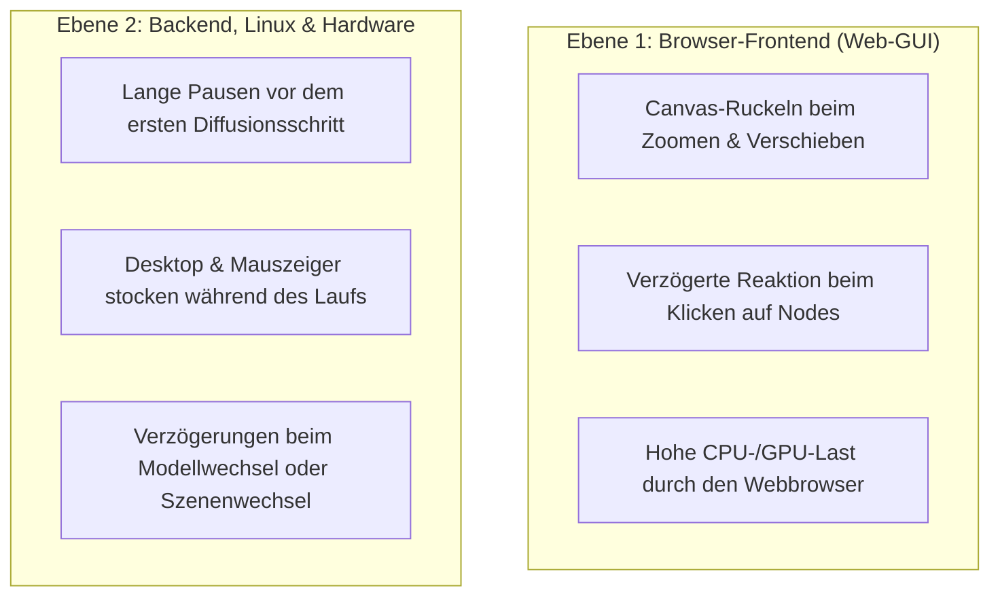

# ⚡ ComfyUI Performance, GUI-Tuning & Flüssiges Arbeiten

> **Ziel:** Vollständige Beseitigung von Rucklern, Denkpausen und Desktop-Stottern beim Arbeiten mit ComfyUI und großen 32B-Videomodellen (MiniMax H3 / Wan) auf der AMD Radeon PRO W7800.

---

## 1. Die zwei Dimensionen von „ComfyUI läuft nicht flüssig“

Wenn ComfyUI als zäh oder ruckelig empfunden wird, liegt die Ursache fast immer in einer von zwei klar trennbaren Ebenen:



---

## 2. Ebene 1: Browser-Frontend (Canvas & GUI flüssig machen)

ComfyUI zeichnet den gesamten Workflow (Nodes, Regler, Verbindungskabel) über die HTML5-Canvas-Engine *LiteGraph*. Bei großen Workflows mit über 100 Nodes geraten viele Browser ins Stocken.

### 🛠️ 1. Verbindungskabel von „Spline“ auf „Straight“ stellen (Größter Hebel!)
* **Problem:** Standardmäßig berechnet ComfyUI jede Verbindungslinie als mathematisch geschwungene Bézier-Kurve (*Spline*). Bei 150+ Linien muss der Browser bei jeder minimalen Mausbewegung tausende Stützpunkte pro Sekunde neu berechnen.
* **Lösung:**
  1. Klicke oben rechts im ComfyUI-Menü auf das **Zahnrad (Settings)**.
  2. Suche die Einstellung **`Link Render Mode`** (oder *Links*).
  3. Stelle von `Spline` um auf **`Straight`** (Gerade Linien) oder **`Linear`**.
  * **Ergebnis:** Die Framerate beim Zoomen und Verschieben auf dem Canvas verzehnfacht sich sofort!

### 🧹 2. ComfyUI-Verlauf leeren (`Clear History`)
* **Problem:** Nach mehreren gerenderten Filmen liegen Dutzende hochaufgelöste Videos im internen Ausführungsverlauf. Bei jedem Status-Update sendet der WebSocket gigantische JSON-Pakete samt Bilddaten an den Browser.
* **Lösung:**
  * Klicke im rechten Menü auf **`Clear History`**.

### 🚀 3. Hardware-Beschleunigung im Webbrowser prüfen (Linux)
* **Problem:** Wenn unter Linux im Browser (Chrome/Brave/Firefox) die GPU-Beschleunigung nicht aktiv ist, rendert die CPU das riesige Canvas in Software.
* **Lösung in Chrome / Chromium / Brave:**
  1. Öffne `chrome://settings/system`.
  2. Prüfe, ob **„Grafikbeschleunigung verwenden, falls verfügbar“** aktiviert ist.
  3. Prüfe unter `chrome://gpu`, ob bei *Canvas* und *WebGL* der Status **Hardware accelerated** steht.

### 🙈 4. Große Video-Preview-Nodes einklappen
* **Problem:** Große Video-Player-Nodes, die direkt auf dem Canvas liegen und hochauflösende Videos abspielen, belegen permanent VRAM des Browsers und erzeugen ständige Repaint-Zyklen.
* **Lösung:** Klicke auf den kleinen Pfeil oben links an den `SaveVideo`- oder `PreviewVideo`-Nodes, um sie während der Workflow-Bearbeitung einzuklappen.

---

## 3. Ebene 2: Backend, Linux-Kernel & Hardware-Tuning

### 💾 1. VRAM-Warmstart statt Modell-Offloading
* **Problem:** Ein 32-Milliarden-Parameter-Modell wie MiniMax H3 wiegt über 30 GB auf der SSD. Wird der Speicher zwischen Szenen bereinigt (Offload), muss ComfyUI vor jedem Clip 30 GB von der SSD in den RAM und dann in den VRAM schaufeln $\rightarrow$ **40 bis 50 Sekunden Stillstand ohne Fortschritt**.
* **Lösung:**
  * In [`scripts/auto_movie_maker.py`](../scripts/auto_movie_maker.py) ist standardmäßig `offload_between_scenes=False` aktiv.
  * Das Modell bleibt im 48 GB VRAM der W7800 gepinnt. Neue Szenen starten ohne Nachladezeit sofort in der nächsten Sekunde!

### 🧊 2. Linux Page-Cache & Swap-Thrashing (Desktop-Ruckeln)
* **Problem:** Beim Einlesen von 30 GB großen Safetensors-Dateien belegt der Linux-Kernel den freien RAM als Dateicache (`buff/cache`). Bei Speicherdruck lagert Linux inaktive Desktop-Prozesse (Gnome-Shell, Xorg, Browser) in die SWAP-Datei aus. Wechselt man dann den Desktop, friert das System kurz ein, weil die Daten erst wieder von der SSD gelesen werden müssen.
* **Lösung im Skript:**
  * `auto_movie_maker.py` ruft nach jedem Durchlauf automatisch `cleanup_system_ram_and_swap()` auf (`sync`, `malloc_trim(0)` und `swapoff -a && swapon -a`).
* **Dauerhafte Linux-Optimierung (Swappiness senken):**
  * Setze den Linux-Kernel-Parameter herab, damit erst im äußersten Notfall ausgelagert wird:
    ```bash
    sudo sysctl vm.swappiness=10
    ```
  * Dauerhaft speichern in `/etc/sysctl.d/99-swappiness.conf`:
    ```text
    vm.swappiness=10
    ```

### ⚡ 3. GPU-Taktschwankungen fixieren (DPM Performance Level)
* **Problem:** Im Standardmodus (`auto`) taktet der VRAM der W7800 im Leerlauf auf 96 MHz herunter und springt unter Last auf 1200 MHz. Diese ständigen Taktwechsel können Mikroruckler in der Batch-Pipeline erzeugen.
* **Lösung:**
  * Fixiere den Takt vor der Produktion auf Höchstleistung:
    ```bash
    sudo ./scripts/w7800_perf_boost.sh sweet-spot
    # oder
    sudo ./scripts/w7800_perf_boost.sh boost
    ```
  * Setzt das DPM-Level auf `high` und aktiviert das `COMPUTE`-Profil für optimierte Tensor-Schleifen.

### 🧬 4. Einmalige Shader-Kompilierung bei neuer Auflösung (ROCm)
* **Normales Verhalten:** Wenn du zum ersten Mal von 0.4 MP auf 0.6 MP oder 0.7 MP wechselst, muss ROCm / PyTorch beim ersten Step die GPU-Shader für das neue Tensor-Format kompilieren.
* **Dauer:** Das dauert einmalig **45 bis 75 Sekunden**, in denen scheinbar nichts passiert.
* **Abhilfe:** Geduld beim 1. Schritt einer neuen Auflösung – ab Schritt 2 läuft der KSampler mit gewohnter Höchstgeschwindigkeit durch.

---

## 4. Reale Performance-Erwartungswerte (MiniMax H3)

MiniMax H3 ist kein 2-Sekunden-Bildmodell (wie SDXL mit 2.6B Parametern), sondern ein **32B DiT + 32B Vision-Encoder + 125 Video-Frames + synchrone Audio-Synthese**.

Auf der AMD Radeon PRO W7800 (RDNA 3, 205W–230W) gelten folgende realistische Richtwerte:

| Auflösung | Schrittdauer (Turbo LoRA) | Renderzeit (5s Clip, 8 Steps) | Renderzeit (5s Clip, 10 Steps) |
| :--- | :---: | :---: | :---: |
| **0.4 MP** ($864 \times 480$) | ~7–8s / Step | ~70–80 Sekunden | ~90–100 Sekunden |
| **0.6 MP** ($1056 \times 608$) | ~9–10s / Step | ~95–105 Sekunden | ~110–120 Sekunden |
| **0.7 MP** ($1152 \times 640$) | ~11–12s / Step | ~115–125 Sekunden | ~135–145 Sekunden |
| **0.98 MP** ($1344 \times 768$) | ~15–17s / Step | ~155–165 Sekunden | ~185–200 Sekunden |

---

## 5. Schnelle Checkliste für ein butterweiches System

- [x] In ComfyUI-Settings: **`Link Render Mode` auf `Straight`** gestellt.
- [x] ComfyUI-Rechtsklick: **`Clear History`** geklickt.
- [x] Webbrowser: **Grafikbeschleunigung** ist aktiv.
- [x] GPU-Boost: **`w7800_perf_boost.sh sweet-spot`** (oder `adaptive`) aktiv.
- [x] Langfilm-Pipeline: **`offload_between_scenes=False`** (VRAM-Warmstart aktiv).
- [x] Linux: **`vm.swappiness=10`** gesetzt.

