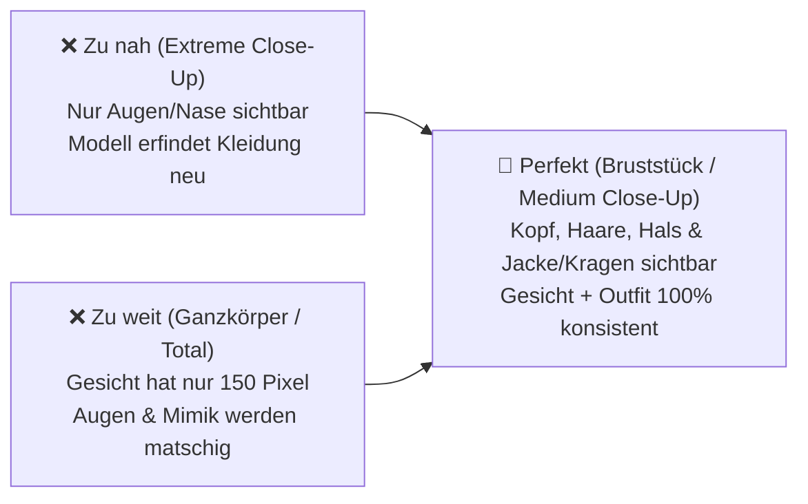

# 📸 Perfekte Quellbild-Vorbereitung für KI-Video (MiniMax H3 & Wan)

> **Kernprinzip (Garbage in, Garbage out):** Die Qualität und Konsistenz eines KI-Videos hängt zu 70% vom Master-Referenzbild ab. MiniMax H3 projiziert die Pixel-DNA dieses Bildes auf jede einzelne Bewegung.

---

## 1. Bildausschnitt & Komposition (Framing)

Der Bildausschnitt entscheidet, welche Merkmale das Modell lernt:

### 🌟 Das goldene Format: Das „Bust-Shot“ (Bruststück)
* **Kopf bis oberer Brustbereich:** Das Gesicht füllt ca. 50–60% der Bildhöhe aus.
* **Warum?** 
  1. Das Gesicht hat genug Auflösung, damit der CLIP-Vision-Encoder Pupillen, Hautporen und Falten scharf erfassen kann.
  2. Der Kragen / die Kleidung (z. B. Trenchcoat-Revers, taktischer Stehkragen, Krawatte) ist deutlich sichtbar $\rightarrow$ die Kleidung bleibt im Video stabil!

---

## 2. Mimik, Pose & Blickrichtung

MiniMax H3 „friert“ die Mimik des Startbildes oft als Grundzustand ein.

| Kriterium | 🌟 Perfekt (Best Practice) | ❌ Vermeiden |
| :--- | :--- | :--- |
| **Mimik** | **Neutral bis subtiles Lächeln / Fokus:** Mund geschlossen, Lippen entspannt. | **Offener Mund mit Zähnen, Lachen, Grimassen:** Das Modell lässt die Zähne sonst im gesamten Video sichtbar („Grusel-Lächeln“). |
| **Blickwinkel** | **Leichtes Halbprofil (3/4-Ansicht) oder Frontal:** Zeigt Nasenrücken, Wangenknochen und beide Augen. | **Hartes 90°-Profil:** Das Modell kennt die andere Gesichtshälfte nicht und halluziniert sie bei Kopfdrehungen falsch. |
| **Blickrichtung** | **Richtung Kamera oder knapp daran vorbei:** Direkter visueller Kontakt. | **Extrem nach oben/unten verdrehte Augen.** |
| **Freie Sicht** | Gesicht ist vollkommen frei von Händen, Haaren oder Gegenständen. | Sonnenbrille (außer die Figur trägt sie immer), Mikrofone, vorgehaltene Hände. |

---

## 3. Beleuchtung & Hintergrund

* **Hintergrund (Freistellung & Tiefe):**
  * Wähle einen **ruhigen, unscharfen Hintergrund (Bokeh)** oder neutralen Raum.
  * **Wichtig:** Keine zweiten Personen oder Schaufensterpuppen im Hintergrund! Das neuronale Netz kann sonst nicht unterscheiden, wer der eigentliche Charakter `<Picture 1>` ist.
* **Licht:**
  * Bevorzuge **cinematisches, weiches Licht** (z. B. Drei-Punkt-Beleuchtung oder dezentes Seitenlicht).
  * **Vermeide extreme Überbelichtung:** Ausgebranntes Weiß auf Stirn oder Nase verliert alle Hauttexturen.
  * **Vermeide Pechschwarz:** Dunkle Schlagschatten führen dazu, dass die KI eine Gesichtshälfte im Video verformt.

---

## 4. Die 2-Stufen-Veredelung mit FaceDetailer (ComfyUI)

Wende niemals den FaceDetailer nachträglich auf fertige Videoframes an (erzeugt extremes Flimmern). **Veredle stattdessen das Quellbild vor Drehstart!**

### Workflow: `_minimax_h3_face_detailer_master.json`
Mit dem installierten ComfyUI-Workflow schärfst du Porträts auf 4K-Mikroschärfe:

1. **Detector:** `face_yolov8m.pt` (erkennt Männer und Frauen zuverlässig).
2. **Segment Anything:** `sam_vit_b_01ec64.pth` (erzeugt weiche Masken ohne Ränder).
3. **Denoise-Stärke (Entscheidend):**
   * **`0.30 – 0.35` (Empfohlen):** Die Gesichtsgeometrie bleibt zu 100% identisch; Augen, Iris, Wimpern und Poren werden fotorealistisch nachgeschärft.
   * `> 0.50` (Zu hoch): Das Gesicht verwandelt sich in eine andere Person!

---

## 5. Ideale Auflösung & Dateiformat

* **Auflösung:** 
  * Ideal: **$1024 \times 1536$ bis $1536 \times 2048$** (z. B. 2:3 oder 3:4 Hochformat) oder **$1024 \times 1024$** (Quadratisch).
  * Höher als $2048 \times 2048$ bringt keinen Qualitätsgewinn, da der CLIP-Vision-Encoder intern herunterskaliert.
  * Kleiner als $768 \times 768$ führt zu pixeligen Augen im Video.
* **Format:**
  * **8-bit PNG (Lossless RGB)** oder **unkomprimiertes WebP / TIFF**.
  * Keine stark komprimierten JPGs mit Kompressions-Artefakten (Blöckchenbildung).

---

## 6. Checkliste vor Drehbeginn

Vor dem Start von `./scripts/run_1min_movie.sh`:

- [x] Ist nur **eine einzige Person** auf dem Foto?
- [x] Ist der Mund **geschlossen** und der Ausdruck neutral?
- [x] Sind **Augen und Iris gestochen scharf** (keine verschwommenen Pupillen)?
- [x] Ist die **Kleidung (Kragen/Jacke) klar erkennbar**?
- [x] Liegt das Bild als saubere `.png`-Datei in `ComfyUI/input/`?

